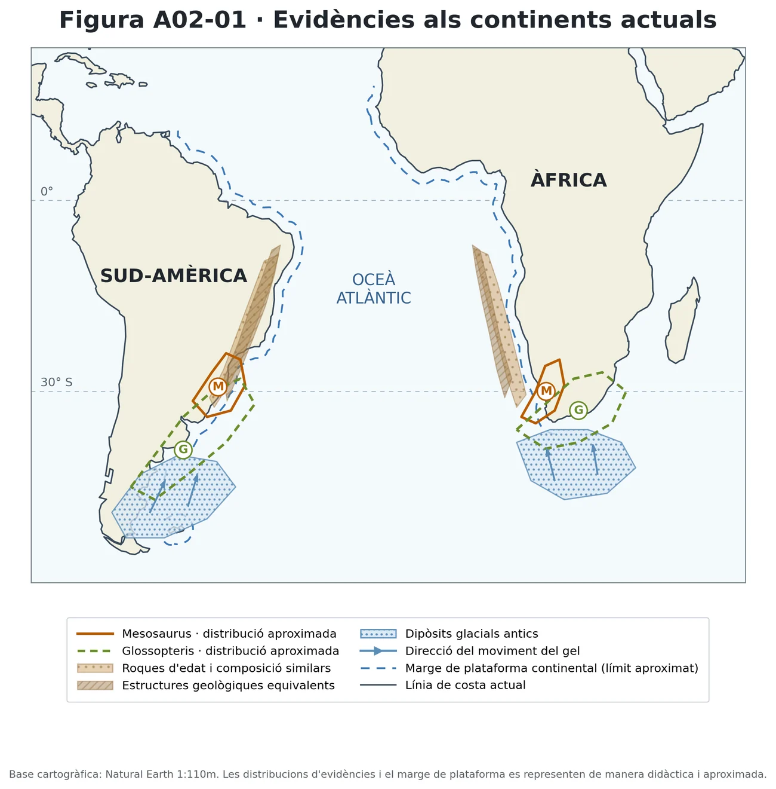
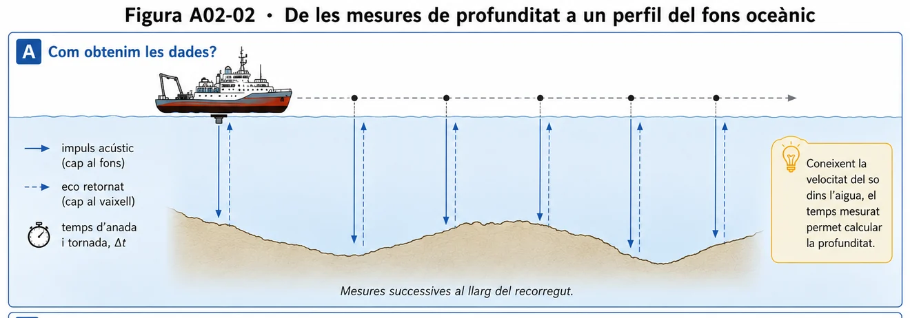
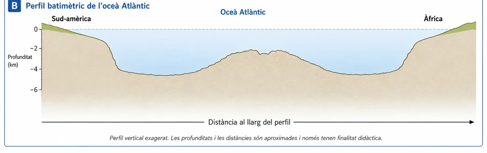
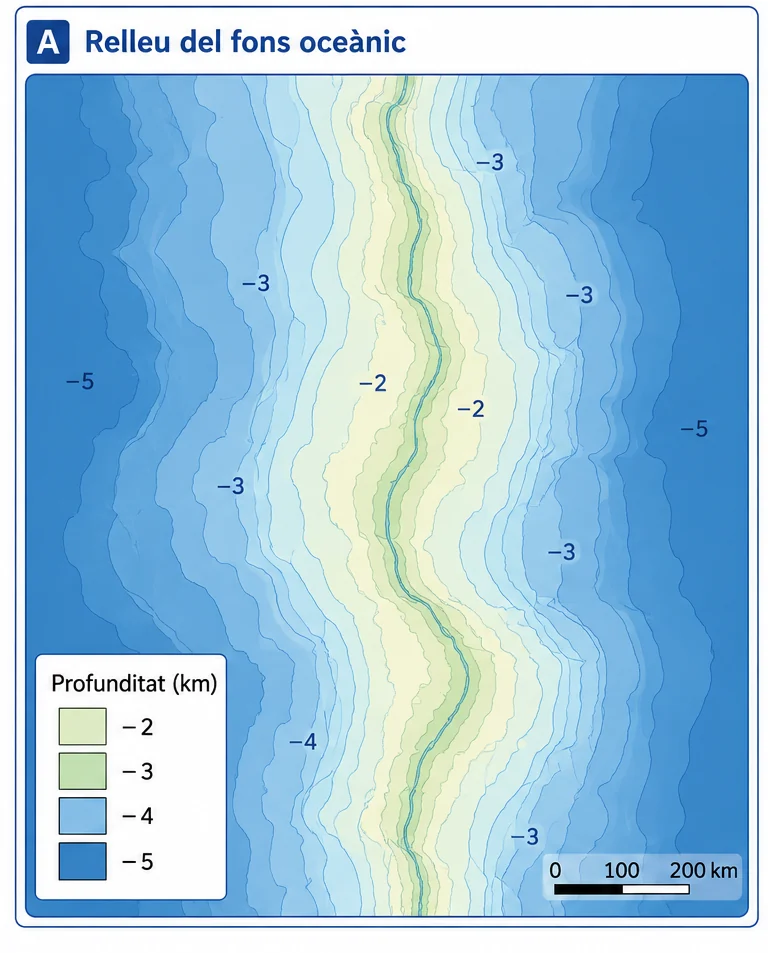
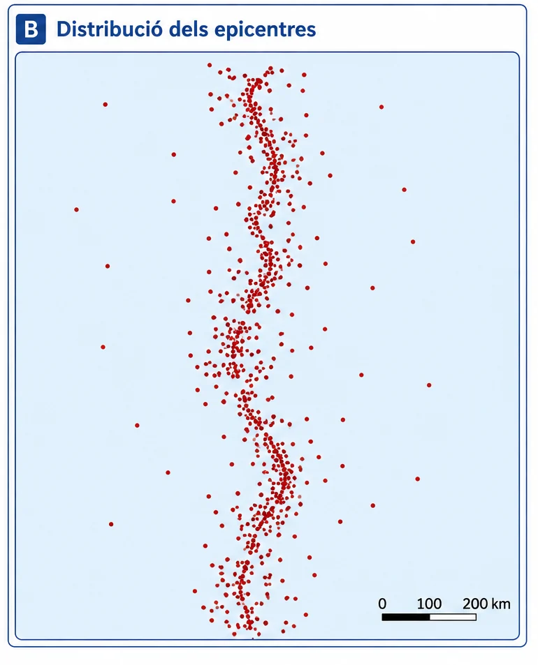
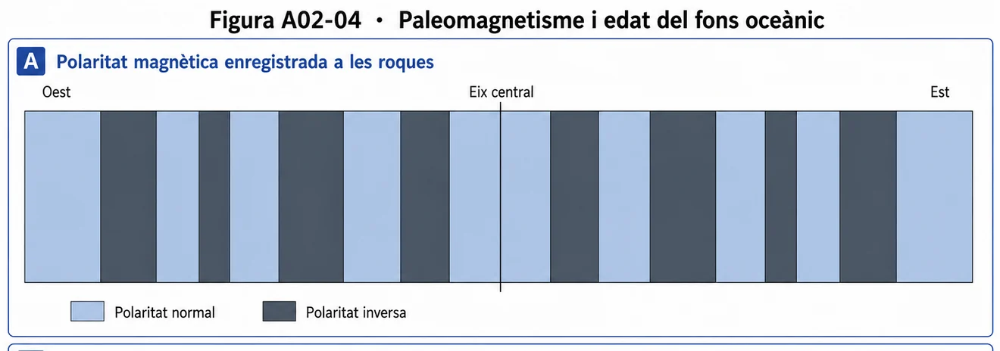
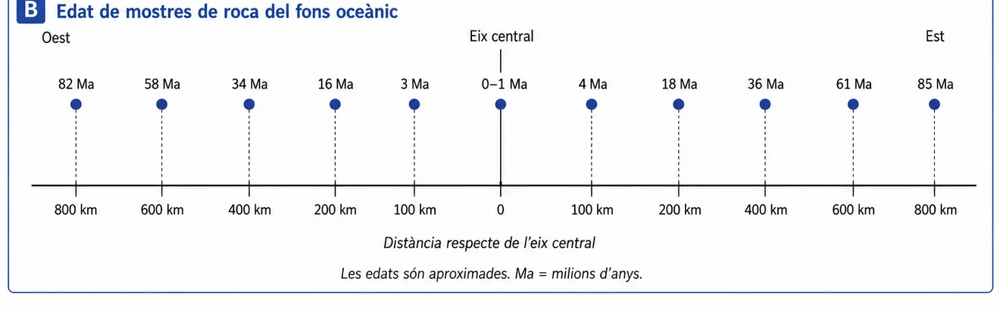

<section class="pv-seccio pv-portada" markdown>

# A02 · Com canvia una teoria científica?

## Si tenim proves que els continents es mouen, per què va costar dècades arribar a una teoria que ho explicàs?

**UD02 · Una Terra dinàmica · Biologia, Geologia i Ciències Ambientals · 1r de Batxillerat**

**La nostra investigació:** observam evidències, proposam models, feim prediccions i comprovam què canvia quan apareixen dades noves.

**Organització:** els episodis 1–7 es treballen de manera guiada i les aportacions són formatives. L'episodi 8 és individual i recull dues evidències d'avaluació diferenciades.

Les dades s'aniran revelant en cada episodi.

<button type="button" class="a02-boto-secundari" data-a02-reset>Reinicia totes les revelacions i les prediccions desades en aquest dispositiu</button>

<small>Les anotacions escrites en aquesta pàgina només es desen, quan és possible, en aquest navegador: **no s'envien al professorat**. Pots fer-les també al quadern. Aquesta web no recull qualificacions.</small>

</section>

<section class="pv-seccio pv-visual" markdown>

## 1 · Wegener: les primeres evidències

A començaments del segle XX, Alfred Wegener va reunir observacions que eren difícils d'explicar si els continents sempre haguessin ocupat la mateixa posició.

<figure class="a02-figura a02-mapa">
  
  <figcaption>Figura A02-01 · Evidències continentals. Extreta de la fitxa original.</figcaption>
</figure>

<strong>Quines coincidències observau? Quina hipòtesi permet explicar-les conjuntament?</strong>

**Primer, pensa-hi individualment; després, contrasta-ho amb una parella.** Triau almenys dues observacions per defensar la hipòtesi.

<label for="a02-h1">Hipòtesi provisional (opcional si la registrau al quadern)</label>
<textarea id="a02-h1" data-a02-resposta="wegener" rows="3" placeholder="Proposam que... perquè observam..."></textarea>

<button class="a02-revela" type="button" data-a02-target="a02-e1-conclusio" aria-controls="a02-e1-conclusio" aria-expanded="false">Contrastam la hipòtesi</button>

**Primera conclusió provisional.** Les coincidències són compatibles amb una antiga unió continental i el desplaçament posterior. Cap d'aquestes coincidències no constitueix, per si mateixa, una observació directa del moviment.

**Compara aquesta conclusió amb la hipòtesi inicial.** Hi ha alguna diferència important? Modificaries alguna cosa de la teva explicació? Comentau-ho oralment; no cal escriure una altra resposta.

</section>

<section class="pv-seccio" markdown>

## 2 · Un model que encara té un problema

Wegener va proposar que els continents havien estat units i posteriorment s'havien desplaçat. El model relacionava diverses observacions, però els mecanismes físics que proposava no eren satisfactoris.

<strong>A</strong>
Tenim evidències compatibles amb el moviment continental.

<strong>B</strong>
Tenim un mecanisme físic satisfactori que explica el moviment.

<strong>Disposar de proves compatibles amb A implica necessàriament que B sigui certa?</strong>

**Debat en parelles.** Què hauria de poder explicar un model més complet?

<button class="a02-revela" type="button" data-a02-target="a02-e2-conclusio" aria-controls="a02-e2-conclusio" aria-expanded="false">Fixam què sabem i què ens falta</button>

**Què explica?** Un conjunt de coincidències continentals que apunten a una unió anterior.

**Què no explica encara satisfactòriament?** Quin procés físic permet el desplaçament de grans masses litosfèriques.

**Atenció:** Wegener sí que va proposar mecanismes; el problema era que no resultaven físicament convincents.

</section>

<section class="pv-seccio pv-visual" markdown>

## 3 · Descobrim el fons oceànic

### 3.1 · Mesuram allò que no podem veure

Durant molt temps, el relleu dels grans oceans era poc conegut. Les campanyes oceanogràfiques varen començar a acumular mesures amb ecosondes.

<figure class="a02-figura">

<figcaption>Figura A02-02A · De l'eco acústic a les mesures de profunditat.</figcaption>
</figure>

<strong>Què mesura directament l'ecosonda? Com podem transformar aquestes mesures en un perfil del fons?</strong>

<button class="a02-revela" type="button" data-a02-target="a02-e3-perfil" aria-controls="a02-e3-perfil" aria-expanded="false">Revelam el perfil reconstruït</button>

<figure class="a02-figura">

<figcaption>Figura A02-02B · Perfil del fons de l'oceà Atlàntic.</figcaption>
</figure>

**Observau sense explicar encara l'origen:** el fons no és una plana uniforme. A la zona central destaca una dorsal amb una depressió axial.

**Pregunta per continuar:** com podríem saber si aquesta estructura també és geològicament activa?

### 3.2 · Una segona font de dades

Examinam ara el relleu batimètric de la regió.

<figure class="a02-figura a02-panel-estret">

<figcaption>Figura A02-03A · Relleu del fons oceànic.</figcaption>
</figure>

<strong>Quin patró hi observau? Quina altra font de dades ens podria informar sobre l'activitat d'aquesta regió?</strong>

<button class="a02-revela" type="button" data-a02-target="a02-e3-sismicitat" aria-controls="a02-e3-sismicitat" aria-expanded="false">Revelam una nova font de dades</button>

<figure class="a02-figura a02-panel-estret">

<figcaption>Figura A02-03B · Distribució dels epicentres.</figcaption>
</figure>

**Contrastau les dues fonts de dades.** On es concentren els terratrèmols respecte de la dorsal? Quina inferència és raonable? Què **no** demostra encara aquesta coincidència?

**Discutiu primer una conclusió pròpia.** Quan la tengueu, contrastau-la amb la formulació científica que apareixerà a continuació.

<button class="a02-revela" type="button" data-a02-target="a02-e3-conclusio" data-a02-open-label="Conclusió revelada" aria-controls="a02-e3-conclusio" aria-expanded="false">Contrastam la nostra interpretació</button>

**Conclusió provisional.** El relleu i la sismicitat suggereixen que la dorsal oceànica és una zona geològicament activa, perquè la concentració de terratrèmols coincideix amb aquesta estructura submarina. Tanmateix, aquestes dades no permeten concloure, per si soles, que s'hi forma nova escorça oceànica ni que el fons s'expandeix cap als dos costats.

**Comparau-la oralment amb la vostra interpretació.** Què havíeu identificat correctament? Què precisaríeu? No cal copiar la conclusió.

</section>

<section class="pv-seccio" markdown>

## 4 · Marie Tharp: ciència col·lectiva

El coneixement científic no apareix a partir d'un únic tipus de tasca. Les campanyes oceanogràfiques obtenien mesures de profunditat al llarg dels recorreguts dels vaixells. Marie Tharp transformava grans quantitats de mesures en perfils i mapes del relleu submarí.

En estudiar l'Atlàntic, va identificar una depressió associada a la serralada submarina. La comparació posterior amb dades de sismicitat va reforçar la interpretació que aquella regió era geològicament activa.

<strong>«El coneixement del fons oceànic va ser el descobriment d'una sola persona.» Què té d'incompleta aquesta afirmació?</strong>

**En parelles**, identificau almenys dues tasques científiques diferents necessàries per obtenir i interpretar els mapes.

**Després de la posada en comú, contrastau la vostra explicació amb aquesta primera conclusió:**

> **Primera conclusió · Ciència col·lectiva.** Les campanyes oceanogràfiques proporcionaven mesures de profunditat. Marie Tharp les analitzava i les integrava en perfils i mapes que ajudaven a reconèixer estructures submarines. Eren tasques diferents, però complementàries.

**Una altra qüestió:** totes les persones que participaven en aquestes investigacions tenien les mateixes oportunitats de fer recerca?

<button class="a02-revela" type="button" data-a02-target="a02-e4-context" aria-controls="a02-e4-context" aria-expanded="false">Incorporam el context de la recerca</button>

Durant anys, Marie Tharp no va poder embarcar en determinades campanyes oceanogràfiques pel fet de ser dona. Les oportunitats de fer recerca també depenen de les normes i pràctiques de les institucions.

**Discutiu:** com podia afectar aquesta prohibició la participació directa de Tharp en l'obtenció de dades? Per què no anul·la la importància de la seva contribució científica?

**Idea clau:** instruments, equips, disciplines i context institucional condicionen què podem investigar i qui pot fer-ho.

</section>

<section class="pv-seccio pv-visual" markdown>

## 5 · Una hipòtesi que s'arrisca a predir

### 5.1 · Les roques conserven informació magnètica

Quan es refreden algunes roques volcàniques, determinats minerals poden conservar informació sobre la polaritat del camp magnètic terrestre. La polaritat del camp magnètic s'ha invertit moltes vegades al llarg de la història.

Per això el fons oceànic pot registrar successions de polaritat **normal** i **inversa**.

### 5.2 · Predim abans de mirar les dades

Considerau aquesta hipòtesi:

A l'eix de la dorsal es forma roca nova que, amb el temps, s'allunya cap als dos costats.

Per a aquesta **predicció inicial**, imaginau que el moviment és aproximadament semblant als dos costats. No és una propietat que haguem d'atribuir a totes les dorsals.

<strong>Quina successió de bandes de polaritat esperaríeu trobar a banda i banda de la dorsal?</strong>

**Prediu-ho abans de veure la figura**: dibuixau una successió de bandes al quadern o descriviu-la aquí. Compartiu la predicció amb una parella.

<label for="a02-pred-magnetica">La nostra predicció de les bandes magnètiques</label>
<textarea id="a02-pred-magnetica" data-a02-resposta="magnetica" rows="4" placeholder="Esperam que... perquè..."></textarea>
<label class="a02-confirma"><input type="checkbox" data-a02-paper="magnetica"> Ja hem deixat registrada la predicció al quadern.</label>

<button class="a02-revela a02-revela-important" type="button" data-a02-target="a02-e5-polaritats" data-a02-requires="magnetica" aria-controls="a02-e5-polaritats" aria-expanded="false">Hem fet la predicció: revelam les dades magnètiques</button>

<figure class="a02-figura">

<figcaption>Figura A02-04A · Bandes magnètiques enregistrades al fons oceànic.</figcaption>
</figure>

**Contrastau:** quines parts de la vostra predicció concorden amb el patró? Quines no? Que un model sigui compatible amb una observació equival a una demostració absoluta?

**Registre:** no esborreu la predicció inicial; afegiu davall la vostra comparació amb les dades.

</section>

<section class="pv-seccio pv-visual" markdown>

## 6 · Dues evidències independents

Disposem d'una hipòtesi sobre la formació i el desplaçament del fons oceànic. Ara la contrastarem amb una altra font de dades: **l'edat de les roques**.

<strong>Si es forma roca nova a l'eix de la dorsal, on haurien de ser les roques més joves? Com variaria l'edat en allunyar-nos de l'eix?</strong>

**Feis una segona predicció abans de veure les datacions.** Podeu formular-la amb un esquema o amb dues frases.

<label for="a02-pred-edats">La nostra predicció de les edats</label>
<textarea id="a02-pred-edats" data-a02-resposta="edats" rows="3" placeholder="Esperam que les més joves... i que l'edat..."></textarea>
<label class="a02-confirma"><input type="checkbox" data-a02-paper="edats"> Ja hem deixat registrada la predicció al quadern.</label>

<button class="a02-revela a02-revela-important" type="button" data-a02-target="a02-e6-edats" data-a02-requires="edats" aria-controls="a02-e6-edats" aria-expanded="false">Hem fet la predicció: revelam les datacions</button>

<figure class="a02-figura">

<figcaption>Figura A02-04B · Edats de mostres del fons oceànic.</figcaption>
</figure>

**Contrastau la predicció:** quin és el patró general? Fins a quin punt coincideix amb el que havíeu anticipat?

**Important:** les datacions i el magnetisme són fonts d'evidència diferents, no dues lectures del mateix instrument.

<button class="a02-revela" type="button" data-a02-target="a02-e6-integracio" aria-controls="a02-e6-integracio" aria-expanded="false">Integram les dues proves</button>

**Recuperau la figura magnètica de l'episodi 5** i comparau-la amb les edats. Quina mateixa explicació permet interpretar totes dues?

**Registre de fins a tres línies:** connectau formació de fons oceànic, successió de polaritats i edat creixent amb la distància.

</section>

<section class="pv-seccio" markdown>

## 7 · Un model amb més capacitat explicativa

Ara hem reunit cinc línies d'evidència. No es tracta de tornar a respondre totes les preguntes, sinó de reconstruir **què aporta cada una**.

01<strong>Fòssils, geologia i paleoclima</strong><small>Coincidències entre continents</small>

02<strong>Batimetria</strong><small>Dorsal i depressió axial</small>

03<strong>Sismicitat</strong><small>Epicentres agrupats</small>

04<strong>Paleomagnetisme</strong><small>Successió de polaritats als dos costats</small>

05<strong>Datació</strong><small>Edats oceàniques que augmenten amb la distància</small>

<strong>Per parelles: quina inferència permet cada evidència i quin problema ajuda a resoldre?</strong>

No heu d'escriure cinc explicacions llargues. Feis un petit esquema: **evidència → inferència → explicació**.

<button class="a02-revela" type="button" data-a02-target="a02-e7-sintesi" aria-controls="a02-e7-sintesi" aria-expanded="false">Reconstruïm conjuntament el canvi de model</button>

Coincidències continentals → **deriva continental**

Batimetria i sismicitat → **fons oceànic estructurat i actiu**

Bandes magnètiques i edats → **expansió del fons oceànic**

Integració amb altres processos, com la subducció → **tectònica de plaques**

L'expansió oceànica és una peça del model de tectònica de plaques, però **no n'és tota l'explicació**. El model integra diferents processos i observacions. La reconstrucció de l'activitat és didàctica: no representa una cronologia estricta ni una única cadena inevitable de descobriments.

**Discussió final:** una explicació científica és millor simplement perquè és més nova, o perquè explica més observacions, genera prediccions contrastables i reconeix les seves limitacions?

**Transferència social breu:** per què conèixer la relació entre els terratrèmols i les estructures tectòniques pot ser important per a la societat?

</section>

<section class="pv-seccio" markdown>

## 8 · Tancament individual

A partir d'aquí **treballau individualment i lliurau les respostes segons indiqui el professorat**. Els dos apartats generen evidències d'avaluació diferents. Les revelacions dels episodis anteriors són per aprendre; **aquí no hi ha solucions ni autocorrecció**.

### 8.1 · Quan les dades obliguen a afinar un model · CA 4.2

Un equip científic estudia el fons oceànic a banda i banda d'una dorsal. Inicialment proposa aquest model:

> A l'eix de la dorsal es forma roca oceànica nova. Aquesta roca s'allunya de la dorsal cap als dos costats **a la mateixa velocitat**.

Posteriorment obté aquestes datacions de roques. Les distàncies s'han mesurat perpendicularment a l'eix, que s'ha mantingut aproximadament a la mateixa posició durant l'interval estudiat.

| Edat de la roca | Distància a l'oest | Distància a l'est |
|---:|---:|---:|
| 10 Ma | 100 km | 150 km |
| 20 Ma | 200 km | 300 km |
| 30 Ma | 300 km | 450 km |

*Dades simulades per a aquesta activitat.*

**a)** Analitza el model inicial a partir de les noves dades. **Quina part del model queda qüestionada i quina continua essent compatible amb les observacions?** Justifica la resposta utilitzant com a mínim dues dades de la taula.

**b)** **Reformula el model** modificant allò que les dades posen en qüestió, però sense descartar les parts que continuen essent compatibles. Explica com el model revisat permet interpretar la distribució de les edats i les distàncies.

**c)** Una banda paleomagnètica representa roca formada durant un interval determinat de polaritat del camp magnètic. Si el teu model revisat fos correcte, **com esperaries que fossin les amplades de les bandes corresponents al mateix interval de temps a cada costat de la dorsal?** Justifica la predicció.

### 8.2 · Com es construeix una teoria científica? · CA 2.3

Una exposició sobre la història de la geologia inclou aquesta explicació:

> «La tectònica de plaques es va construir gràcies a dues persones: Wegener va proposar que els continents es movien i Marie Tharp va demostrar que el fons oceànic s'expandia. A partir d'aquella demostració, es varen abandonar els models anteriors.»

**Pregunta**

Analitza críticament aquesta afirmació i redacta una explicació més ajustada de com es va construir la teoria de la tectònica de plaques.

En la teva argumentació:

- Distingeix què té d'encertat l'afirmació i què simplifica o presenta incorrectament.
- Relaciona contribucions de persones i disciplines diferents, les dades obtingudes i la importància dels instruments.
- Explica quina va ser la contribució de Marie Tharp i com el context social o institucional va condicionar la seva participació en la recerca.
- Indica breument una utilitat social de comprendre millor la distribució dels terratrèmols.

**No basta enumerar noms o descobriments:** has d'explicar com les diferents aportacions varen contribuir a millorar els models científics.

*Extensió orientativa: 120–160 paraules. Es valorarà la qualitat de l'argumentació, no la quantitat de text.*

[Obre la versió de la fitxa per imprimir](s5_fitxa_alumnat.md){ .a02-enllac-fitxa }

</section>

