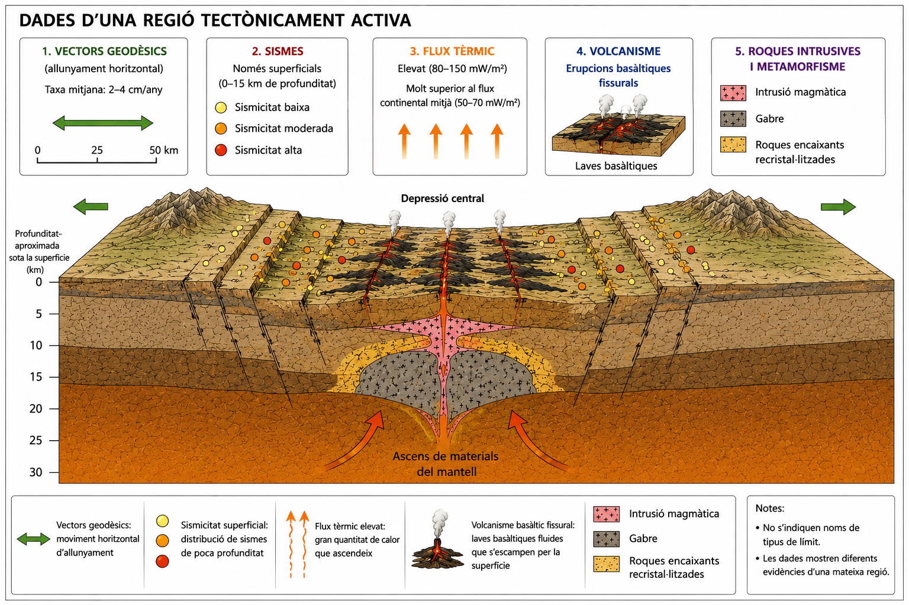

# A03 · Una litosfera que transforma materials

**UD02 · Una Terra dinàmica · Biologia, Geologia i Ciències Ambientals · 1r de batxillerat**

> **Pregunta inicial.** Si ja sabem com es mouen les plaques, podem predir què passarà amb els materials?

En aquesta activitat utilitzaràs la tectònica de plaques com a model per interpretar dades i explicar la formació de magmes, de roques ígnies i els processos metamòrfics. **Respon les preguntes i completa les taules al quadern**, indicant el número de cada apartat.

## 1. La tectònica de plaques com a eina per fer prediccions

Ja coneixes els principals tipus de límits de plaques. Ara no es tracta de recordar-ne els noms, sinó d'utilitzar el model per interpretar dades.

### 1.1. Interpretam quatre regions tectòniques

Observa les quatre regions de la figura 1. Les fletxes ja indiquen el moviment relatiu de les plaques: **no les utilitzis com a evidència per justificar el context tectònic**. Fixa't en el relleu, la profunditat dels terratrèmols i la presència o absència de vulcanisme.

Completa la taula. Per a cada regió, identifica el **context tectònic** i indica **dues evidències geològiques** de la figura que permetin justificar-lo.

| Regió | Context tectònic | Dues evidències geològiques de la figura |
|---|---|---|
| A | | |
| B | | |
| C | | |
| D | | |

### 1.2. Comparam dos contextos de convergència

Les regions **B i C** mostren plaques que s'aproximen. Tot i això, no presenten les mateixes característiques geològiques.

**Explica** quines diferències observes en la **distribució i profunditat dels terratrèmols, el vulcanisme i el relleu**, i relaciona-les amb els processos que tenen lloc en cada regió.

### 1.3. Feim una predicció i proposam com comprovar-la

Tria **una** de les quatre regions i respon:

1. **Predicció:** indica una característica geològica **observable i comprovable** que esperaries trobar-hi a partir del model de tectònica de plaques, però que **no aparegui representada directament a la figura**. Evita prediccions genèriques: concreta què esperaries observar i on.
2. **Contrast:** quina observació o dada nova permetria comprovar si la predicció és correcta? Indica també quin resultat esperaries obtenir si la predicció es compleix.

Justifica breument la relació entre el context tectònic, la predicció i la dada que proposes obtenir.

## 2. Per què es forma magma?

El mantell és majoritàriament sòlid. Per tant, l'existència de volcans no es pot explicar simplement dient que «a l'interior de la Terra fa molta calor».

Una roca pot començar a fondre's parcialment quan canvien les condicions de pressió, temperatura o la presència de determinats volàtils, com l'aigua.

### 2.1. Interpretam els mecanismes de fusió parcial

Observa els tres panells de la figura 2. Els eixos representen la **pressió** i la **temperatura**; les línies indiquen, de manera simplificada, les condicions a partir de les quals pot començar la fusió parcial. Fixa't tant en el desplaçament del material com en els canvis del límit d'inici de fusió.

Completa la taula a partir de la figura. A la columna «Què es manté aproximadament constant?», indica les **condicions de pressió o temperatura del material**, quan pertoqui; al panell B, distingeix aquestes condicions del **canvi en el límit d’inici de fusió** causat per l’aigua. **No confonguis una temperatura elevada amb la presència de material fos.**

| Panell | Què canvia? | Què es manté aproximadament constant? | Per què pot començar la fusió parcial? |
|---|---|---|---|
| A · Descompressió | | | |
| B · Incorporació de volàtils | | | |
| C · Aportació de calor | | | |

**Pregunta d'interpretació.** Al panell B, per què l'aportació d'aigua pot afavorir la fusió parcial **sense que augmenti la temperatura**? Explica què passa amb el límit d'inici de fusió.

### 2.2. Aplicam el model a contextos tectònics

**Situació A · Una dorsal oceànica**

El mantell ascendeix sota una regió on les plaques se separen.

**Explica** per què pot començar la fusió parcial encara que el material no experimenti un augment important de temperatura. Relaciona la teva resposta amb un dels mecanismes de la figura 2.

**Situació B · Una zona de subducció**

Una placa oceànica s'enfonsa i allibera aigua cap al mantell situat per damunt.

**Explica** com aquesta aportació d'aigua pot afavorir la formació de magma. Per què **no** és correcte afirmar simplement que «la placa que s'enfonsa es fon»? Relaciona la resposta amb la figura 2.

**Idea a vigilar.** La fusió geològica acostuma a ser **parcial**: no implica necessàriament fondre tota una roca o tota una capa. **Escalfar una roca tampoc no implica necessàriament que es fongui**; segons les condicions, pot experimentar transformacions en estat sòlid, com veurem a l'apartat 4.

## 3. Del magma a les roques

Dues roques poden tenir composicions globals semblants i, en canvi, presentar textures molt diferents.

### 3.1. De la textura a la història de refredament

Les dues roques tenen una composició global semblant.

**Compara** el basalt i el gabre de la figura 3. Descriu la diferència observable en la **mida dels cristalls** i explica quina **història de refredament i solidificació** és compatible amb cada roca. Relaciona la textura amb la velocitat de refredament i el lloc on probablement s'ha solidificat.

### 3.2. Què podem saber només observant la textura?

Un alumne observa una roca ígnia amb cristalls grossos i afirma:

> «És un gabre perquè s'ha refredat lentament».

**Explica** quina part del seu raonament és compatible amb les evidències i quina conclusió **no està justificada**. Quina informació addicional necessitaria per identificar la roca?

## 4. Canviar sense fondre: el metamorfisme

Una roca pot experimentar canvis importants de mineralogia, textura o estructura sense arribar a fondre's. Aquest conjunt de transformacions en estat sòlid constitueix el metamorfisme.

### 4.1. Comparam dos contextos metamòrfics

Observa els dos contextos de la figura 4 i completa la taula. Relaciona les transformacions de les roques amb el procés geològic que les provoca i amb les condicions en què tenen lloc.

| Aspecte | Context A | Context B |
|---|---|---|
| Procés geològic que provoca les transformacions | | |
| Condicions que afavoreixen el metamorfisme | | |
| Distribució espacial de les transformacions | | |
| Tipus de metamorfisme | | |

**Pregunta de comparació.** Per què les transformacions del context A són més intenses a prop de la intrusió, mentre que al context B poden afectar una regió molt més extensa? Relaciona la resposta amb la font de calor i el context tectònic.

### 4.2. Una intrusió, dues transformacions

Una intrusió magmàtica s'emplaça dins unes roques de l'escorça. S'hi observen dues zones:

- **Zona X:** els minerals originals recristal·litzen i se'n formen de nous, però la roca es manté completament sòlida.
- **Zona Y:** una part dels minerals comença a fondre's i apareix una petita proporció de material líquid.

1. **Identifica i justifica** quin procés té lloc a cada zona. Explica quina evidència permet distingir les transformacions en estat sòlid de l'inici de la fusió parcial.
2. **Explica** per què no és correcte afirmar que qualsevol roca escalfada per una intrusió es transforma en magma.

## 5. Explicam un sistema geològic

**Tancament individual · CA 4.1**

Resol aquest apartat **individualment**. Utilitza les dades per construir explicacions geològiques i justifica les relacions que proposis.

En una regió geològica s'han obtingut les dades següents: dos sectors de la litosfera s'allunyen lentament; els terratrèmols són majoritàriament superficials; el flux de calor és superior al de les regions pròximes; hi ha laves basàltiques i, en profunditat, s'han identificat cossos de gabre. Al voltant d'una intrusió magmàtica s'observa una franja de roques encaixants amb cristalls recristal·litzats i minerals nous.

### 5.1. Interpretam les evidències

Identifica el context tectònic més compatible amb el conjunt de dades. **Justifica'l amb almenys dues evidències geològiques diferents del moviment de separació** i explica com es relacionen amb la dinàmica de les plaques. No basta enumerar-les.

### 5.2. Reconstruïm els processos

Explica com la dinàmica tectònica d'aquesta regió pot donar lloc a la formació de magma i a dues roques de composició semblant, el **basalt** i el **gabre**, però amb textures diferents.

### 5.3. Explicam una transformació diferent

Al voltant de la intrusió magmàtica s'observen roques amb cristalls recristal·litzats i minerals nous. **Explica** quin procés pot haver produït aquestes transformacions, com es relaciona amb la intrusió i per què no és necessari que les roques s'hagin fos.

---

**En acabar A03 hauries de ser capaç de:** inferir un context tectònic a partir de dades; explicar mecanismes de fusió parcial; relacionar textura i refredament; distingir metamorfisme i fusió; i connectar dades, processos i materials.