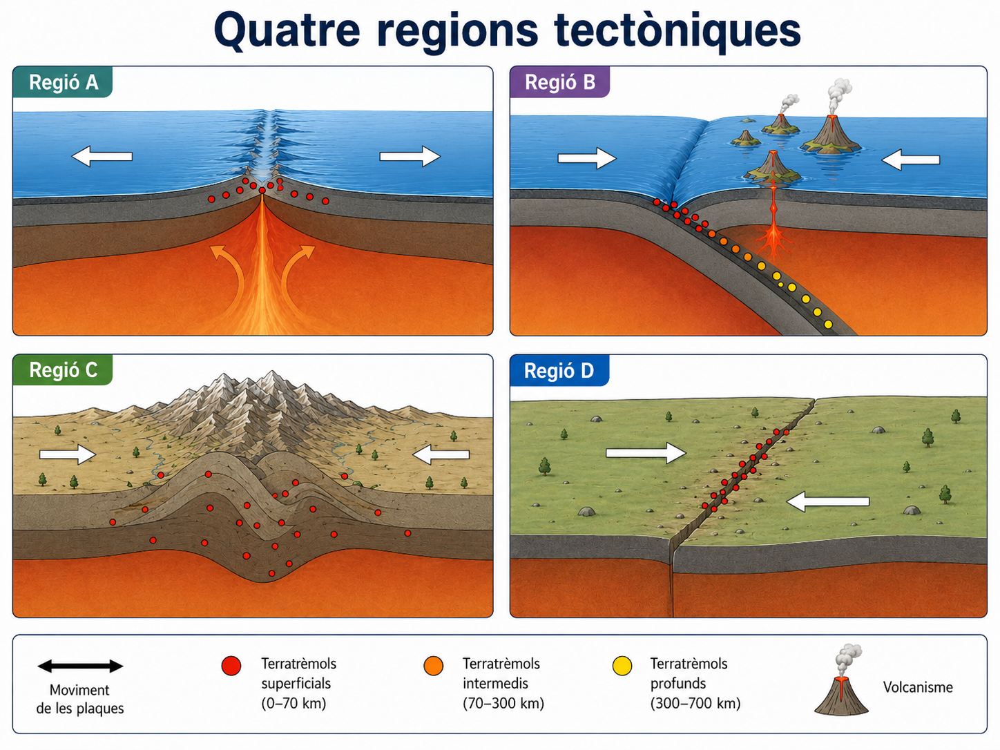
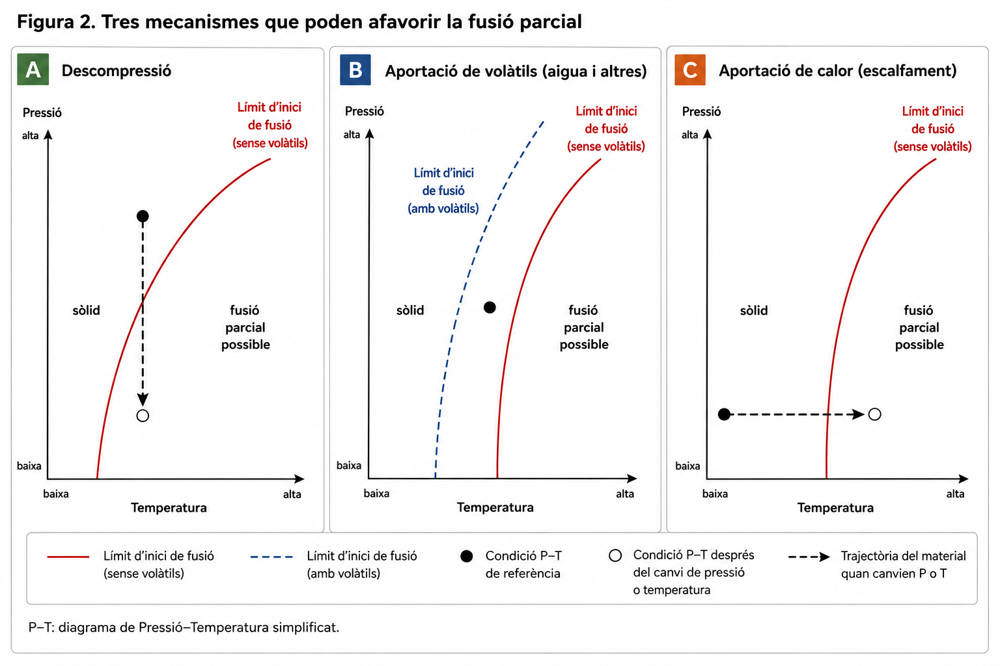
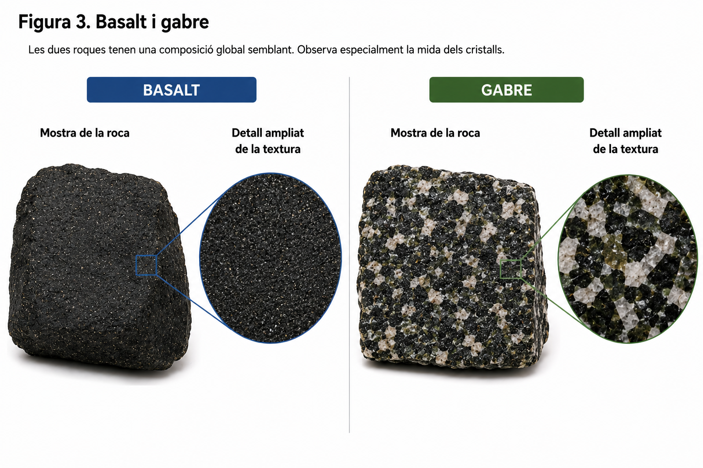
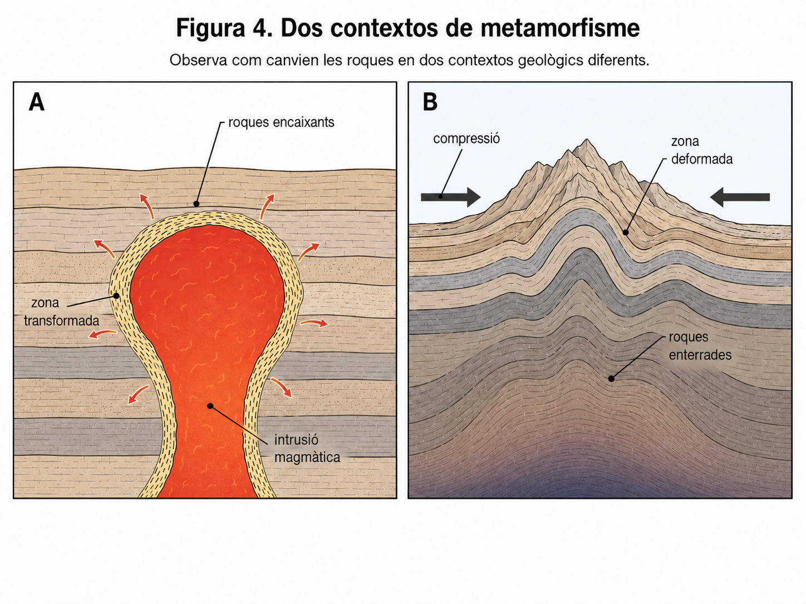

<section class="pv-seccio pv-portada" markdown>

# A03 · Una litosfera que transforma materials

## Què podem predir sobre les estructures i les roques d'una regió si coneixem la dinàmica de les plaques?

**UD02 · Una Terra dinàmica · Biologia, Geologia i Ciències Ambientals · 1r de batxillerat**

Aquesta pàgina serveix per **explorar, contrastar i repassar** allò que explicam a classe. Pots fer les comprovacions al teu ritme, també si no has pogut assistir a una sessió. **No has d'emplenar taules ni lliurar res al quadern.** Les interaccions són formatives i no recullen qualificacions.

Treballarem una idea: **context tectònic → condicions físiques → processos geològics → estructures i materials esperables**. També la utilitzarem en sentit invers: de les observacions a una explicació plausible.

**Nivell que necessitam:** distingir roques sedimentàries, metamòrfiques i ígnies (volcàniques i plutòniques), explicar el paper dels minerals i els cristalls, reconèixer textures i justificar processos. **No cal identificar andesita, diorita, granodiorita ni altres roques específiques a partir del context tectònic.** El basalt i el gabre apareixeran com a exemples treballats.

> **Per consultar o repassar:** [Material guia · 4. Com transforma els materials una Terra activa?](../../../material/ud2/ud2/#4-com-transforma-els-materials-una-terra-activa)

</section>

<section class="pv-seccio" markdown>

## 1 · Què ens revela el context tectònic?

Observa primer les quatre regions de la figura. Abans de llegir les explicacions, fixa't en **el relleu, les fosses, la profunditat dels terratrèmols i el vulcanisme**. Les fletxes indiquen moviments, però no han de ser la teva única evidència.

### Investiga cinc situacions

Llegeix cadascuna i tria el context que explica millor **el conjunt** de dades. Després comprova l'explicació. Pots encertar una etiqueta per intuïció; el que importa és entendre **per què**.

Situació 1

Hi ha una fossa oceànica, terratrèmols cada vegada més profunds terra endins i volcans damunt una serralada situada al marge d'un continent.

<button type="button" data-a03-choice="wrong" data-a03-why="En una dorsal les plaques se separen, el relleu principal és una serralada submarina i la sismicitat és sobretot superficial.">Divergència oceànica</button><button type="button" data-a03-choice="right" data-a03-why="La fossa i la sismicitat inclinada són compatibles amb una placa oceànica que subdueix sota un continent; el magmatisme pot alimentar un arc volcànic continental.">Subducció oceànica-continental</button><button type="button" data-a03-choice="wrong" data-a03-why="La col·lisió entre dos continents produeix habitualment escurçament i engruiximent de l'escorça, però no aquest patró de fossa i volcans de subducció.">Col·lisió continental</button>

Tria una explicació.

Situació 2

Hi ha una fossa i una cadena d'illes volcàniques en arc, amb terratrèmols de profunditat diversa. Les dues plaques que s'aproximen són oceàniques.

<button type="button" data-a03-choice="right" data-a03-why="Una placa oceànica subdueix sota l'altra i el vulcanisme pot construir illes damunt la placa superior oceànica.">Subducció oceànica-oceànica</button><button type="button" data-a03-choice="wrong" data-a03-why="Les falles transformants produeixen sismicitat i desplaçament lateral, però no una fossa amb arc insular volcànic com a conseqüència característica.">Límit transformant</button><button type="button" data-a03-choice="wrong" data-a03-why="La dorsal correspon a separació de plaques i formació de fons oceànic, no a una fossa de subducció.">Divergència oceànica</button>

Tria una explicació.

Situació 3

Una gran serralada continental presenta plecs i falles inverses; dos grans sectors continentals s'aproximen. No hi ha una cadena contínua de volcans actius associada a la serralada.

<button type="button" data-a03-choice="wrong" data-a03-why="En una subducció oceànica-continental esperaríem poder trobar una fossa i sismicitat relacionada amb una placa oceànica descendent.">Subducció oceànica-continental</button><button type="button" data-a03-choice="right" data-a03-why="L'escurçament, el plegament, les falles inverses i l'engruiximent són coherents amb una col·lisió continental, on pot dominar el metamorfisme regional.">Col·lisió continental</button><button type="button" data-a03-choice="wrong" data-a03-why="Un límit transformant implica lliscament lateral, no una aproximació continental extensa amb engruiximent crustal característic.">Límit transformant</button>

Tria una explicació.

Situació 4

Una serralada submarina presenta terratrèmols superficials i activitat volcànica. Les roques més joves són al seu centre i es fan més antigues cap als costats.

<button type="button" data-a03-choice="right" data-a03-why="A una dorsal es forma escorça oceànica nova al centre, que després s'allunya amb les plaques: per això l'edat augmenta cap als costats.">Divergència oceànica</button><button type="button" data-a03-choice="wrong" data-a03-why="La subducció destrueix litosfera oceànica al límit i presenta un patró de fosses i sismes a profunditat variable.">Subducció oceànica-oceànica</button><button type="button" data-a03-choice="wrong" data-a03-why="El lliscament lateral no explica la formació continuada de roques oceàniques noves a l'eix d'una serralada submarina.">Límit transformant</button>

Tria una explicació.

Situació 5

Dues plaques llisquen lateralment al llarg d'una zona de falla. S'hi concentren terratrèmols principalment superficials, sense creació sistemàtica de nova escorça ni arc volcànic associat.

<button type="button" data-a03-choice="wrong" data-a03-why="Una dorsal implica separació i creació de nova escorça, no moviment principalment lateral.">Divergència oceànica</button><button type="button" data-a03-choice="wrong" data-a03-why="Una col·lisió continental genera escurçament i engruiximent, no només lliscament lateral.">Col·lisió continental</button><button type="button" data-a03-choice="right" data-a03-why="Les falles transformants acomoden el moviment lateral de les plaques i poden generar molts sismes sense vulcanisme sistemàtic.">Límit transformant</button>

Tria una explicació.

Què tenen en comú un arc d'illes i una serralada volcànica continental?

**Tots dos poden formar-se en zones de subducció.** Comparteixen fossa, terratrèmols a diferents profunditats i magmatisme. La diferència essencial és el tipus d'escorça de la **placa superior**: oceànica en un arc d'illes, continental en un arc volcànic continental. No hem de deduir una litologia única per a cada context.

Tots els límits de plaques produeixen terratrèmols i volcans?

No. La sismicitat és freqüent en límits transformants i col·lisions continentals, però no implica necessàriament vulcanisme. Fins i tot en contextos convergents, el resultat depèn de quina litosfera hi intervé i de la història de la regió.

</section>

<section class="pv-seccio" markdown>

## 2 · Què fa que una roca comenci a fondre's?

El mantell és **majoritàriament sòlid**. La fusió sol ser parcial: no fonen tots els minerals ni una capa sencera. A partir de la figura, distingeix tres maneres d'arribar a les condicions d'inici de fusió.

### Construeix dues cadenes causals

En cada cas, selecciona **quin canvi de les condicions** pot afavorir la fusió parcial, **quin material és el que es pot fondre** i **quin resultat podem esperar**. La comprovació t'explicarà què s'ha de revisar.

Cas 1 · Una dorsal oceànica

El mantell calent ascendeix a la regió on dues plaques oceàniques se separen.

<label>Quin canvi afavoreix la fusió?
<select data-a03-step="pressio"><option value="">Tria...</option><option value="descompressio">Disminució de la pressió</option><option value="aigua">Incorporació d'aigua</option><option value="fred">Disminució de temperatura</option></select></label>
<label>Quin material pot experimentar fusió parcial?
<select data-a03-step="material"><option value="">Tria...</option><option value="mantell">Part del mantell que ascendeix</option><option value="placa">Tota la placa oceànica</option><option value="sediments">Només els sediments del fons marí</option></select></label>
<label>Què és plausible que es formi després?
<select data-a03-step="resultat"><option value="">Tria...</option><option value="ignees">Magma que origini roques ígnies</option><option value="metamorfiques">Exclusivament roques metamòrfiques</option><option value="sedimentaries">Exclusivament roques sedimentàries</option></select></label>

<button type="button" class="a03-comprova" data-a03-check>Comprova la cadena</button>

Cas 2 · Una zona de subducció

Una placa oceànica descendeix i allibera aigua cap a la regió de mantell situada al damunt.

<label>Quin canvi afavoreix la fusió?
<select data-a03-step="pressio"><option value="">Tria...</option><option value="descompressio">Disminució de la pressió</option><option value="aigua">Disminució de la temperatura necessària per iniciar la fusió per l'efecte de l'aigua</option><option value="fred">Disminució de temperatura</option></select></label>
<label>Quin material pot experimentar fusió parcial?
<select data-a03-step="material"><option value="">Tria...</option><option value="mantell">Part del mantell situat per damunt de la placa descendent</option><option value="placa">Tota la placa que subdueix</option><option value="sediments">Exclusivament els sediments oceànics</option></select></label>
<label>Què és plausible que es formi després?
<select data-a03-step="resultat"><option value="">Tria...</option><option value="ignees">Magma que pugui alimentar roques i edificis volcànics</option><option value="metamorfiques">Exclusivament roques metamòrfiques</option><option value="sedimentaries">Exclusivament roques sedimentàries</option></select></label>

<button type="button" class="a03-comprova" data-a03-check>Comprova la cadena</button>

Predicció 3

Una intrusió calenta transfereix calor a les roques encaixants. Si algunes arriben a les condicions necessàries, què podria passar?

<button type="button" data-a03-choice="wrong" data-a03-why="L'augment de temperatura no obliga tota la roca a fondre's; pot originar metamorfisme, i només si les condicions ho permeten, fusió parcial.">Totes les roques es fonen completament</button><button type="button" data-a03-choice="right" data-a03-why="La calor pot produir canvis metamòrfics en estat sòlid i, si és suficient, fusió parcial de determinats materials.">Metamorfisme o, en alguns casos, fusió parcial</button><button type="button" data-a03-choice="wrong" data-a03-why="Una intrusió magmàtica pot transferir energia i modificar els minerals i l'estructura de les roques properes.">Cap transformació perquè les roques són sòlides</button>

Tria una resposta i comprova'n la causa.

Compara dorsal i subducció en una sola explicació

A la **dorsal**, l'ascens del mantell fa disminuir la pressió i pot afavorir la fusió parcial per **descompressió**. A la **subducció**, els fluids alliberats per la placa descendent poden reduir la temperatura d'inici de fusió al mantell situat per damunt. Tots dos contextos poden originar magma, però no pel mateix mecanisme principal.

</section>

<section class="pv-seccio" markdown>

## 3 · Què ens expliquen els minerals, els cristalls i les textures?

**Mineral:** sòlid natural amb estructura interna ordenada i composició química dins certs marges. **Cristall:** part d'un sòlid on la disposició de les partícules segueix un ordre intern. **Roca:** material geològic natural, generalment format per un agregat de minerals, però també pot contenir vidre volcànic.

Comprovació 1

Dues mostres minerals tenen un color semblant, però una ratlla el vidre i l'altra no. Quina afirmació és la més justificada?

<button type="button" data-a03-choice="wrong" data-a03-why="Un color semblant no garanteix una mateixa identitat mineral; la duresa relativa aporta informació addicional.">Són el mateix mineral, perquè tenen el mateix color</button><button type="button" data-a03-choice="right" data-a03-why="La duresa és una propietat útil per distingir minerals; no ens basta el color, ni una única propietat per identificar-los sempre.">La duresa relativa aporta una evidència addicional</button><button type="button" data-a03-choice="wrong" data-a03-why="Una propietat de ratllat no determina per si sola si el mineral és un silicat o un carbonat.">El que ratlla el vidre ha de ser un silicat</button>

Comprova la teva interpretació.

Per repassar: què vol dir que un mineral sigui un silicat o un carbonat?

Es refereix al **grup químic/estructural** al qual pertany, no a la mida dels cristalls ni al context tectònic on el trobam. Per identificar minerals empram propietats i dades de composició, no únicament el color.

### Un mateix magma, roques amb textures diferents

Comprovació 2

Dos materials ígnis de composició semblant presenten mides de cristall molt diferents. Quina interpretació és més coherent?

<button type="button" data-a03-choice="right" data-a03-why="Si la resta de condicions són comparables, un refredament més lent afavoreix cristalls més grossos, mentre que un refredament ràpid sol produir textures més fines.">Històries de refredament diferents</button><button type="button" data-a03-choice="wrong" data-a03-why="La mida dels cristalls, tota sola, no demostra una composició química diferent.">Composicions necessàriament diferents</button><button type="button" data-a03-choice="wrong" data-a03-why="La textura no identifica per si sola una regió tectònica concreta.">Un procedeix sempre d'una dorsal i l'altre d'una subducció</button>

Comprova la teva interpretació.

Comprovació 3

Veus una roca ígnia de cristalls grossos, però no en coneixes la composició mineralògica. Què pots afirmar?

<button type="button" data-a03-choice="wrong" data-a03-why="No n'hi ha prou amb la mida dels cristalls per assegurar que és gabre: necessitaríem dades de composició/mineralogia.">Que és gabre</button><button type="button" data-a03-choice="right" data-a03-why="Una textura de cristalls grossos és compatible amb cristal·lització relativament lenta; la identitat petrogràfica necessita altres evidències.">Que probablement ha cristal·litzat relativament lentament</button><button type="button" data-a03-choice="wrong" data-a03-why="La roca podria haver-se format en diversos contextos tectònics; les textures no n'identifiquen un d'únic.">Que s'ha format en una dorsal oceànica</button>

Comprova la teva interpretació.

### Classificar pel procés, no memoritzar noms

Material X

Una roca preexistent desenvolupa minerals nous per canvis de pressió i temperatura, però no arriba a fondre's.

<button type="button" data-a03-choice="wrong" data-a03-why="Les roques ígnies es formen per solidificació de magma o lava, no per recristal·lització en estat sòlid.">Ígnia</button><button type="button" data-a03-choice="right" data-a03-why="El metamorfisme transforma roques preexistents en estat sòlid i pot originar nous minerals i textures.">Metamòrfica</button><button type="button" data-a03-choice="wrong" data-a03-why="Les sedimentàries es formen per processos sedimentaris, no principalment per augment de pressió i temperatura en estat sòlid.">Sedimentària</button>

Classifica el procés.

Material Y

Uns sediments s'acumulen, es compacten i es cimenten.

<button type="button" data-a03-choice="right" data-a03-why="La compactació i la cimentació poden transformar sediments en una roca sedimentària.">Sedimentària</button><button type="button" data-a03-choice="wrong" data-a03-why="El metamorfisme implica transformacions mineralògiques/texturals en estat sòlid sota noves condicions, no només compactació i cimentació.">Metamòrfica</button><button type="button" data-a03-choice="wrong" data-a03-why="Una roca plutònica és una roca ígnia que cristal·litza a partir de magma en profunditat.">Ígnia plutònica</button>

Classifica el procés.

Quina relació hi ha entre «ígnia», «volcànica» i «plutònica»?

**Ígnia** i **magmàtica** són sinònims en aquesta classificació. Una roca ígnia pot ser **volcànica** si solidifica a la superfície a partir de lava, o **plutònica** si cristal·litza a partir de magma en profunditat. El basalt i el gabre són exemples treballats, no etiquetes que puguem assignar només per la mida del cristall.

</section>

<section class="pv-seccio" markdown>

## 4 · Com es transformen les roques sense arribar a fondre's?

Context 1

Prop d'una intrusió calenta, una roca presenta nous minerals i recristal·lització. L'efecte és més intens a prop del contacte.

<button type="button" data-a03-choice="right" data-a03-why="És compatible amb metamorfisme de contacte: la intrusió aporta calor a les roques encaixants sense que calgui que es fonguin.">Metamorfisme de contacte</button><button type="button" data-a03-choice="wrong" data-a03-why="La descompressió afavoreix la fusió parcial en contextos com les dorsals, no explica per si sola l'aurèola metamòrfica d'una intrusió.">Fusió per descompressió</button><button type="button" data-a03-choice="wrong" data-a03-why="Si la roca encaixant no s'ha fos i solidificat, no és necessari considerar-la ígnia.">Cristal·lització d'una roca ígnia</button>

Quin procés és més coherent?

Context 2

En una gran serralada continental, extensos volums de roques han quedat enterrats, deformats i sotmesos a noves condicions de pressió i temperatura.

<button type="button" data-a03-choice="wrong" data-a03-why="El contacte sol produir-se a les proximitats d'una intrusió, no és la causa necessària d'aquestes transformacions regionals extenses.">Metamorfisme de contacte</button><button type="button" data-a03-choice="right" data-a03-why="L'enterrament, la deformació i els canvis de pressió i temperatura durant la formació de serralades poden originar metamorfisme regional.">Metamorfisme regional</button><button type="button" data-a03-choice="wrong" data-a03-why="La roca pot transformar-se en estat sòlid; no necessita fondre's per adquirir nous minerals o textures.">Fusió completa de les roques</button>

Quin procés és més coherent?

### Un material pot tenir més d'una història possible

Pensa en una roca sedimentària que queda enterrada. Pot transformar-se en una roca metamòrfica **sense fondre's**. En altres condicions, part del material pot arribar a fondre's, generar magma i, després de la cristal·lització, formar una roca ígnia.

Mostra dues rutes possibles dins el cicle litològic

**Ruta A:** roca sedimentària (**calcària**, formada principalment pel mineral **calcita**) → enterrament i augment de pressió i temperatura → **metamorfisme amb recristal·lització en estat sòlid** → roca metamòrfica (**marbre**, format principalment per **calcita**).

**Què ha canviat?** La textura i l'organització dels cristalls de calcita. **Què s'ha mantingut?** El mineral principal, la calcita. La roca no s'ha hagut de fondre.

**Ruta B:** roca preexistent → fusió parcial en condicions adequades → magma → cristal·lització → roca ígnia.

El cicle litològic és una **xarxa de transformacions possibles**, no una roda amb un ordre obligatori per a totes les roques.

Per revisar abans de la fitxa: quina cadena causal has d'explicar?

Un bon raonament no es limita a posar una etiqueta: **observació geològica → context compatible → canvi de condicions → procés → resultat esperable**. Per exemple, a una dorsal: roques joves prop de l'eix → divergència oceànica → ascens del mantell i disminució de pressió → fusió parcial → magma que pot generar roques ígnies.

---

## Fitxa final individual · CA 4.1

**Ara ja pots aplicar aquests models a regions noves.** El tancament individual consisteix a interpretar dades i justificar explicacions geològiques. Les preguntes interactives d'aquesta pàgina són per practicar i repassar, no compten per a la qualificació.

<a href="https://www.canva.com/d/2zQjJAwWuo5wwwh" class="md-button md-button--primary" target="_blank" rel="noopener noreferrer" aria-label="Obre la fitxa final individual A03-UD02 a Canva">Obre la fitxa final individual · CA 4.1</a>

*La fitxa s'obre en una pestanya nova de Canva, des d'on es pot consultar i preparar per imprimir.*

</section>

