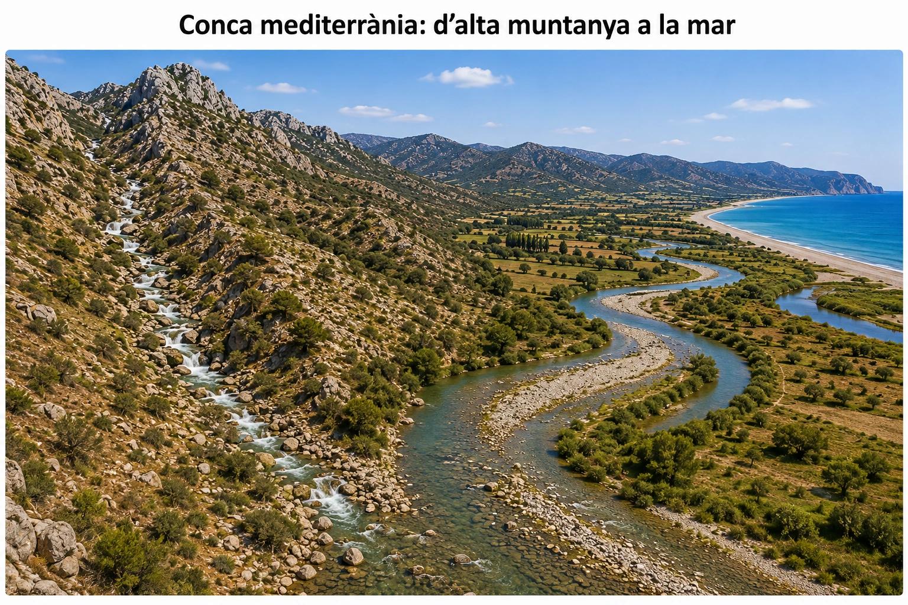

# A04-UD02 · Llegim un paisatge nou

**Tancament individual · possible evidència de CA 4.1**  
**Nom i llinatges:** ____________________  **Grup:** ______  **Data:** __________

Aquest document és **independent de la web de consulta i repàs**. El professor decidirà si es recull i es qualifica. Reprodueix les demandes del tancament individual de la fitxa A04-UD02 original; no incorpora exercicis nous.

**Dades complementàries**  
**Dada 1.** A la part alta de la conca el pendent és elevat.  
**Dada 2.** A la plana baixa el pendent és molt menor i la velocitat habitual del corrent disminueix.

## 1. Observam abans d'explicar

Identifica **tres observacions concretes** de la figura que aportin informació sobre processos geològics externs. No escriguis encara la interpretació: descriu què observes.

## 2. De la muntanya a la plana

Explica una possible seqüència de processos que transformi una roca de la capçalera en un sediment dipositat a la plana baixa.

**meteorització · erosió · transport · sedimentació**

Relaciona els processos causalment.

## 3. Per què sedimenten aquí?

Explica per què els sediments tendeixen a acumular-se a la zona baixa utilitzant les dues dades proporcionades.

**pendent → velocitat de l'aigua → capacitat de transport → sedimentació**

## 4. Dos sòls diferents

Compara el sòl de la part alta del vessant amb el de la zona baixa. Proposa una diferència esperable entre tots dos i explica-la a partir dels processos que hi actuen.

## 5. Una explicació insuficient

> «La forma d'aquest paisatge depèn només de la quantitat de pluja.»

Explica per què aquesta conclusió és insuficient. Indica dos altres factors que hauríem de considerar i explica de quina manera cadascun podria influir en el paisatge.