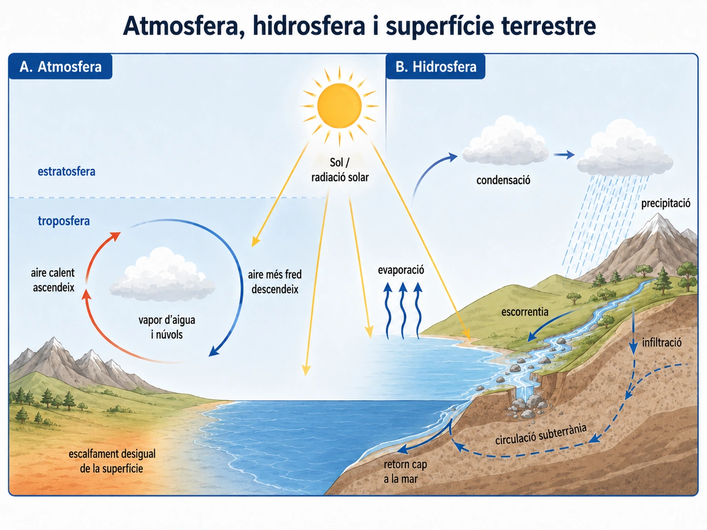
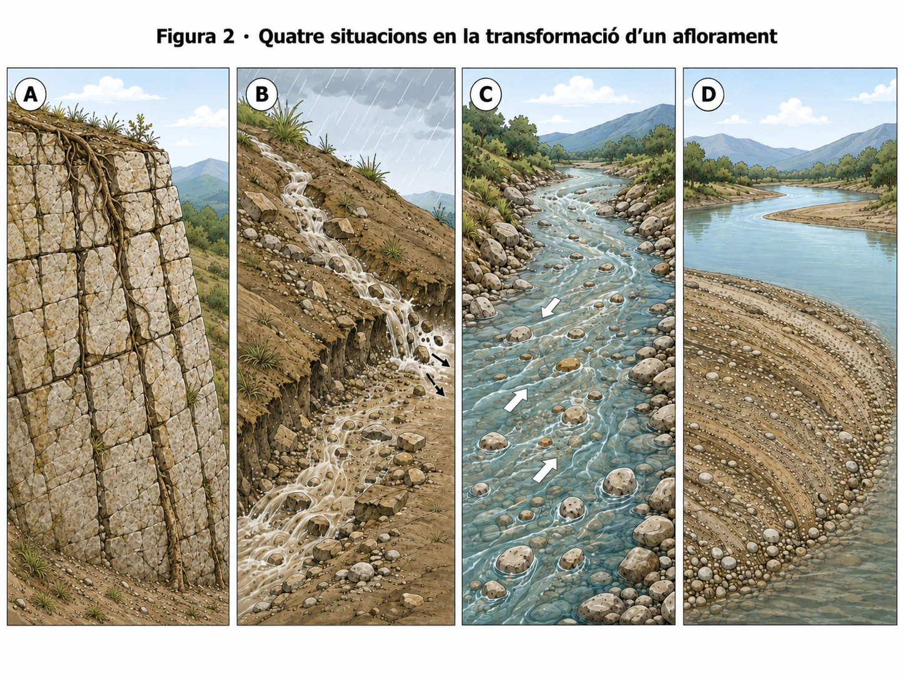
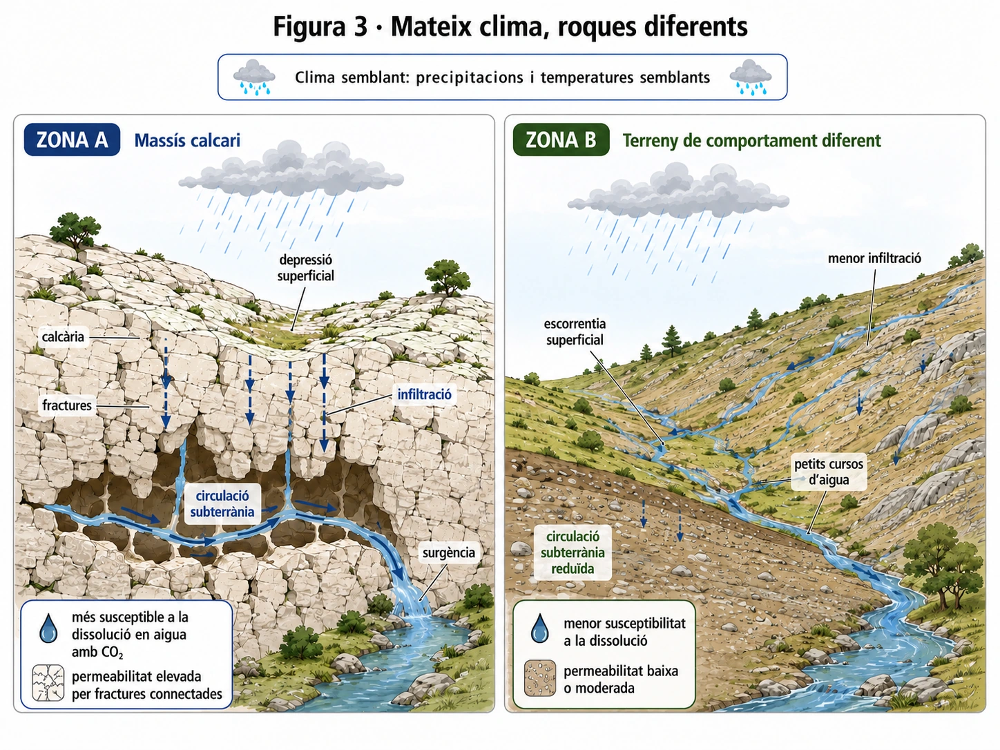
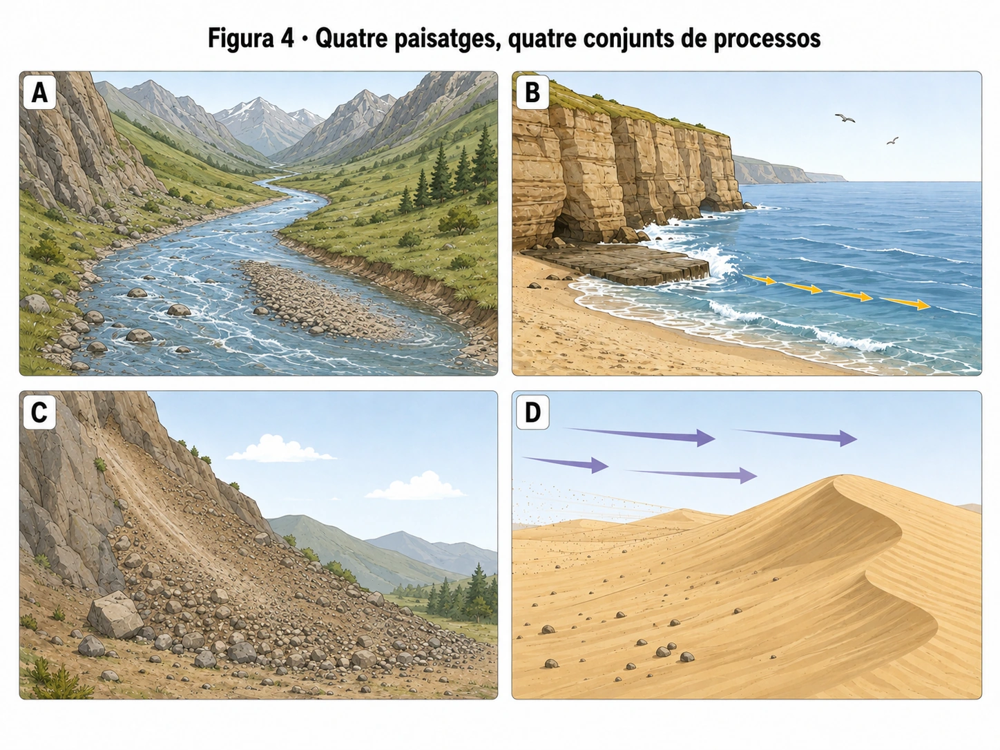
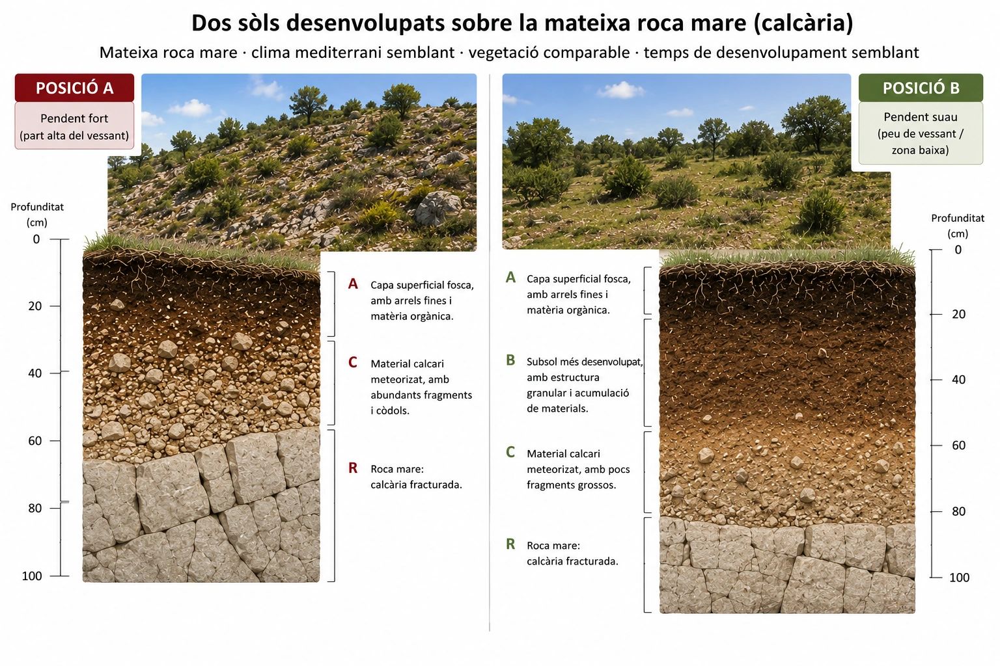

# A04 · Llegim el paisatge

**UD02 · Una Terra dinàmica · Biologia, Geologia i Ciències Ambientals · 1r de batxillerat**

> **Pregunta de partida.** Per què un paisatge té la forma que té?

Un paisatge conserva indicis de processos que es desenvolupen a ritmes molt diferents: alguns, com una avinguda o un despreniment, poden ser ràpids; d'altres actuen durant segles o mil·lennis. Els processos interns poden aixecar o deformar relleus i els externs els transformen i redistribueixen els materials; no és correcte reduir-los a «uns construeixen i els altres destrueixen». Per interpretar-lo no basta posar nom a una forma del relleu. Cal relacionar **allò que observam**, els **processos que proposam** i les **dades que justifiquen la interpretació**.

**En acabar hauries de saber:** explicar la intervenció de l'energia solar i la gravetat; distingir els principals processos geològics externs; relacionar la litologia amb el comportament de l'aigua; interpretar formes de relleu; i explicar com es forma i es conserva el sòl.

---

## 1. Què posa en moviment els materials de la superfície?

<small>Figura 1. Relacions entre l'atmosfera, la hidrosfera i la superfície terrestre.</small>

L'energia que arriba del **Sol** escalfa de manera desigual la superfície i intervé en la circulació atmosfèrica i en el cicle de l'aigua. L'aigua s'evapora, es condensa i pot tornar a la superfície en forma de precipitació. Una vegada arriba a terra, una part es pot infiltrar i una altra pot circular com a escorrentia superficial. Aquests fluxos poden mobilitzar materials i contribuir al modelatge del relleu.

Ara bé, **el Sol no explica per si sol tots els moviments**. La **gravetat** fa que l'aigua circuli cap a cotes més baixes i pot provocar la caiguda de blocs o el desplaçament de materials en un vessant. El modelatge extern resulta de la interacció entre energia, forces, materials i condicions del terreny.

### Una atmosfera amb capes i funcions diferents

L'**atmosfera** és l'embolcall gasós de la Terra, format principalment per nitrogen i oxigen, amb altres gasos, vapor d'aigua i partícules. Participa en la regulació de la temperatura, en el cicle de l'aigua i en la protecció parcial davant radiacions solars perjudicials.

- **Troposfera:** capa inferior, amb la major part de la massa atmosfèrica i del vapor d'aigua. S'hi produeixen la majoria de fenòmens meteorològics. En general, la temperatura hi disminueix amb l'altitud.
- **Estratosfera:** capa superior a la troposfera, amb la major part de l'ozó atmosfèric, que absorbeix una part important de la radiació ultraviolada. A bona part d'aquesta capa, la temperatura augmenta amb l'altitud.

### Per què es mou l'aire?

La superfície de la Terra rep **energia solar de manera desigual**. Això genera diferències de temperatura i pressió: l'aire més calent tendeix a ascendir i el més fred i dens pot ocupar el seu lloc. Aquests contrastos contribueixen a la **circulació atmosfèrica** i als vents, que redistribueixen calor i vapor d'aigua. Per això, l'atmosfera condiciona on i com es produeixen precipitacions, evaporació i molts processos de meteorització i erosió.

### On es troba l'aigua de la Terra?

La **hidrosfera** inclou l'aigua líquida, sòlida i gasosa. La major part és **aigua salada oceànica**; de la petita fracció d'aigua dolça, una part molt important es troba en **gels i neus** o en **aigües subterrànies**. També hi ha aigua dolça en rius, llacs, atmosfera i éssers vius.

La distribució canvia mitjançant el cicle de l'aigua: **evaporació → condensació → precipitació**; després, una part de l'aigua circula com a **escorrentia superficial** i una altra s'**infiltra** i pot alimentar la circulació subterrània. L'energia solar intervé en l'evaporació i la gravetat, entre altres processos, en la caiguda de la precipitació i la circulació superficial i subterrània.

Recupera les idees essencials

- La **troposfera** concentra la major part dels fenòmens meteorològics; l'**estratosfera** conté la major part de l'ozó atmosfèric.
- L'energia solar escalfa de manera desigual la superfície terrestre. Això contribueix a generar diferències de temperatura i pressió que afavoreixen la circulació atmosfèrica. Els moviments de l'aire transporten energia i vapor d'aigua i influeixen en la distribució de les precipitacions.
- **Escorrentia**: circulació de l'aigua per la superfície. **Infiltració**: entrada de l'aigua dins el terreny.
- **Energia solar** i **gravetat** tenen papers diferents però complementaris en la dinàmica externa.

<h4>Comprova-ho · Llegeix una situació</h4>
<fieldset>
<legend>Un bloc de roca es desprèn d’un vessant un dia sense vent ni pluja. Quina explicació és més adequada?</legend>
<label><input type="radio" name="energia" value="a" data-reason="La gravetat també intervé en la dinàmica externa: no necessita una pluja ni un vent actius en el moment del despreniment.">Com que no hi ha pluja ni vent, no hi intervé cap procés geològic extern.</label>
<label><input type="radio" name="energia" value="b" data-reason="La força gravitatòria pot provocar el moviment de blocs pendent avall, sense necessitat d’un corrent d’aigua o d’aire en aquell instant.">La gravetat pot fer caure el bloc encara que no hi hagi aigua ni vent.</label>
<label><input type="radio" name="energia" value="c" data-reason="La pressió atmosfèrica no és una condició necessària per al despreniment; l’estabilitat del massís i la gravetat sí que hi intervenen.">Un despreniment només és possible quan hi ha un canvi sobtat de pressió atmosfèrica.</label>
</fieldset>
<button type="button" class="bgca-verify">Comprova la resposta</button>

Mostra l’explicació raonada

La gravetat actua també quan no hi ha una pluja o un vent que mobilitzi el material. Les fractures, el pendent i la cohesió poden influir en el despreniment.

## 2. Què diferencia meteorització, erosió, transport i sedimentació?

<small>Figura 2. A, aflorament fracturat; B, aigua i materials mobilitzats en un vessant; C, fragments en un corrent; D, acumulació de sediments.</small>

Sovint es representen els processos externs com una cadena: **meteorització → erosió → transport → sedimentació**. És una seqüència útil per entendre molts casos, però **no és una llei que tots els materials hagin de seguir exactament en aquest ordre**.

- **Meteorització:** alteració o disgregació d'una roca **sense necessitat que el material sigui retirat del lloc**. Pot tenir causes físiques, químiques o biològiques.
- **Erosió:** arrencada i retirada de materials d'una superfície per agents com l'aigua, el vent, el gel o per altres processos de mobilització.
- **Transport:** desplaçament dels materials, per exemple per un corrent d'aigua.
- **Sedimentació:** dipòsit o acumulació dels materials quan les condicions permeten que deixin de ser transportats.

### Dos tipus de meteorització que es poden reforçar mútuament

| Tipus | Què canvia? | Exemple o mecanisme |
|---|---|---|
| **Física** | La roca es fragmenta sense modificar substancialment la composició dels minerals. | Creixement de cristalls dins fractures, canvis de temperatura, descompressió o pressió mecànica de les arrels. |
| **Química** | Els minerals experimenten canvis químics. | Dissolució de minerals, oxidació o transformacions químiques en contacte amb l'aigua. |

Aquestes dues formes de meteorització **poden actuar juntes**: les fractures deixen més superfície exposada a l'aigua i l'alteració química pot debilitar la roca i afavorir la fragmentació. Els organismes també hi poden intervenir. Un bloc fracturat, per si sol, no revela necessàriament el mecanisme que el va fracturar.

**Una precaució científica:** una imatge estàtica permet identificar fractures, sediments o acumulacions, però no sempre demostra per si sola quin procés les ha originades. Hem de distingir les evidències visibles del mecanisme que inferim.

<h4>Comprova-ho · Quin procés descriu cada situació?</h4>

Relaciona cadascuna d'aquestes quatre <strong>situacions descrites</strong> amb el procés dominant. En cada cas se n'explicita l'acció: no intentis deduir-la només d'una fotografia.

<label>1. Una roca perd cohesió superficial, però els fragments continuen al lloc.
<select data-correct="meteoritzacio" data-explain="La roca s'altera al mateix lloc, per tant parlam de meteorització.">
<option value="">Tria un procés…</option><option value="meteoritzacio">Meteorització</option><option value="erosio">Erosió</option><option value="transport">Transport</option><option value="sedimentacio">Sedimentació</option></select></label>

<label>2. L'aigua d'una avinguda arrenca sediments que eren al llit d'un torrent.
<select data-correct="erosio" data-explain="L'aigua arrenca i mobilitza materials del llit; això és erosió.">
<option value="">Tria un procés…</option><option value="meteoritzacio">Meteorització</option><option value="erosio">Erosió</option><option value="transport">Transport</option><option value="sedimentacio">Sedimentació</option></select></label>

<label>3. El corrent manté partícules en suspensió i les duu riu avall.
<select data-correct="transport" data-explain="Les partícules ja mobilitzades es desplacen amb l'aigua: és transport.">
<option value="">Tria un procés…</option><option value="meteoritzacio">Meteorització</option><option value="erosio">Erosió</option><option value="transport">Transport</option><option value="sedimentacio">Sedimentació</option></select></label>

<label>4. En una zona de menys velocitat, el corrent deixa dipositats grans de sorra.
<select data-correct="sedimentacio" data-explain="Els grans es dipositen: és sedimentació.">
<option value="">Tria un procés…</option><option value="meteoritzacio">Meteorització</option><option value="erosio">Erosió</option><option value="transport">Transport</option><option value="sedimentacio">Sedimentació</option></select></label>

<button type="button" class="bgca-verify">Comprova les classificacions</button>

Mostra la distinció completa

<strong>Meteorització:</strong> transformació in situ. <strong>Erosió:</strong> arrencada i retirada. <strong>Transport:</strong> desplaçament. <strong>Sedimentació:</strong> dipòsit. Un mateix material pot experimentar aquests processos en moments diferents.

<h4>Comprova-ho · Posa a prova la cadena de processos</h4>
<fieldset>
<legend>Per què no sempre és obligatòria la seqüència meteorització → erosió → transport → sedimentació?</legend>
<label><input type="radio" name="sequencia" value="a" data-reason="Un dipòsit pot ser erosionat de nou; la sedimentació no implica que el material quedi immobilitzat per sempre.">Perquè, una vegada sedimentats, els materials ja no poden tornar a erosionar-se.</label>
<label><input type="radio" name="sequencia" value="b" data-reason="Es poden erosionar sediments ja desagregats sense una nova fase de meteorització prèvia.">Perquè cap material no pot ser erosionat si abans no ha estat meteoritzat.</label>
<label><input type="radio" name="sequencia" value="c" data-reason="La seqüència és un model general, no una norma única per a totes les partícules i tots els ambients.">Perquè alguns materials es poden mobilitzar sense una meteorització prèvia identificable, i poden experimentar diversos episodis de transport i dipòsit.</label>
</fieldset>
<button type="button" class="bgca-verify">Comprova la resposta</button>

Mostra l’explicació raonada

La cadena resumeix processos freqüents, però no imposa un únic ordre irreversible en la història d’un fragment.

### I després de la sedimentació?

Quan els sediments es dipositen poden quedar enterrats per materials nous. Amb el temps, la **compactació** i la **cimentació** poden consolidar-los i originar una roca sedimentària. Aquests processos no han de succeir com dues etapes rígides i completament separades. La compactació redueix l'espai entre grans; la cimentació es produeix quan substàncies dissoltes precipiten i els uneixen. Aquest conjunt de transformacions forma part de la **diagènesi**, i la consolidació del sediment s'anomena **litificació**.

La seqüència descriu moltes roques sedimentàries **detrítiques**, però no totes: també n'hi ha que es formen principalment per **precipitació química** o per acumulació de materials d'origen biològic. Aquestes transformacions formen part del **cicle litològic**.

<h4>Comprova-ho · Com es consolida un sediment?</h4>
<fieldset>
<legend>Quin conjunt de processos pot transformar sediments solts en una roca sedimentària?</legend>
<label><input type="radio" name="litificacio" value="a" data-reason="La fusió i solidificació correspondrien a processos ígnis, no a la litificació habitual de sediments detrítics.">L’augment de pressió fon els grans del sediment i, quan es refreden, ja formen una roca sedimentària.</label>
<label><input type="radio" name="litificacio" value="b" data-reason="Són mecanismes habituals de litificació; compactació i cimentació poden solapar-se.">Enterrament, compactació i cimentació al llarg del temps.</label>
<label><input type="radio" name="litificacio" value="c" data-reason="La compactació pot ser important, però la cimentació també pot contribuir a consolidar molts sediments detrítics.">La compactació és sempre suficient, perquè l’aigua amb minerals dissolts no intervé en la consolidació.</label>
</fieldset>
<button type="button" class="bgca-verify">Comprova la resposta</button>

Mostra l’explicació raonada

Els sediments dipositats poden quedar enterrats; la reducció d’espais i la precipitació de ciment mineral poden consolidar-los.

## 3. Per què dos llocs amb el mateix clima poden tenir paisatges diferents?

<small>Figura 3. Zona A amb calcàries fracturades i circulació subterrània; zona B amb menys infiltració i més escorrentia superficial.</small>

El clima condiciona quanta aigua arriba a un territori i en quines condicions actua, però **la naturalesa i l'estructura de les roques també són decisives**. No és el mateix que una roca sigui fàcilment dissoluble que resistent a la dissolució; tampoc és igual que el terreny tengui fractures obertes i connectades o que l'aigua hi trobi dificultats per penetrar.

Les propietats que ajuden a explicar aquesta resposta són:

| Propietat | Com pot condicionar el modelatge? |
|---|---|
| **Resistència mecànica** | Una roca més resistent pot suportar millor determinats processos de fragmentació i erosió que els materials veïns. |
| **Fracturació** | Les esquerdes poden facilitar l'entrada d'aigua, debilitar el massís i controlar per on circula l'aigua. |
| **Porositat i permeabilitat** | La presència de buits i la possibilitat que estiguin connectats condicionen l'emmagatzematge i la circulació de l'aigua. |
| **Composició mineralògica i susceptibilitat a la dissolució** | Determinen quines reaccions químiques són possibles i la facilitat amb què alguns minerals es dissolen. |

La mateixa roca pot evolucionar de manera diferent en climes diferents, i el mateix agent pot produir respostes distintes segons la litologia. **Cap propietat no explica, tota sola, un paisatge real.**

A la **zona A** de la figura predominen les calcàries fracturades. Part de l'aigua s'infiltra per fractures i pot circular sota terra. A la **zona B**, la menor infiltració afavoreix una circulació més visible per la superfície. Tot i rebre precipitacions i temperatures semblants, el modelatge pot ser diferent.

### Com s'amplia una fractura fins a formar una cavitat càrstica?

Les calcàries estan formades principalment per **calcita**. L'aigua de pluja pot incorporar **CO₂**, sobretot en travessar el sòl. En aquestes condicions pot dissoldre gradualment la calcita. Si penetra per fractures, la dissolució pot eixamplar-les amb el temps, afavorint el desenvolupament de **conductes i cavitats subterrànies**. Aquest és un exemple de **meteorització química**. L'aigua també pot transportar els productes dissolts. En un sistema càrstic poden aparèixer **depressions i solcs a la superfície** i **conductes o cavitats al subsòl**, de manera que un territori amb precipitació apreciable pot tenir poca circulació d'aigua superficial en determinades zones.

El modelatge càrstic és especialment rellevant a les **Illes Balears**, on les roques carbonatades són abundants en diversos indrets.

No basta dir «és calcària i s'hi fan coves»: cal reconstruir el mecanisme **roca + aigua + CO₂ + fractures + dissolució + temps**.

<h4>Comprova-ho · Predicció justificada</h4>
<fieldset>
<legend>A la zona calcària A hi ha més fractures obertes i connectades, mentre que la pluja i la resta de factors es mantenen semblants. Quina predicció és més defensable?</legend>
<label><input type="radio" name="fractures" value="a" data-reason="Més vies obertes i connectades solen facilitar la infiltració, però no permeten calcular-ne la quantitat exacta.">És probable que augmenti la infiltració, perquè l'aigua disposa de més vies connectades cap al subsòl.</label>
<label><input type="radio" name="fractures" value="b" data-reason="La infiltració depèn també de la permeabilitat del terreny; una precipitació igual no implica necessàriament infiltració igual.">La infiltració s'hauria de mantenir igual, ja que la quantitat de pluja no ha variat.</label>
<label><input type="radio" name="fractures" value="c" data-reason="La quantitat i la connexió de fractures no permeten deduir un augment numèric segur sense més dades.">L'augment de fractures permet calcular exactament quant augmentarà la infiltració sense mesurar res més.</label>
</fieldset>
<label class="bgca-writing-label" for="justifica-fractures">Justifica la predicció en una o dues frases: quina propietat canvia i quin mecanisme explica la resposta?</label>
<textarea id="justifica-fractures" rows="3" placeholder="Escriu el mecanisme, no només l'opció triada..."></textarea>
<button type="button" class="bgca-verify">Compara la resposta</button>

Mostra una justificació de referència

La connectivitat de les fractures pot afavorir la infiltració i la circulació d'aigua cap al subsòl. És una <strong>predicció condicionada</strong>, no una certesa quantitativa: en un terreny real hi poden influir l'obturació i altres propietats.

<h4>Comprova-ho · Completa el mecanisme càrstic</h4>
<fieldset>
<legend>Quina explicació connecta correctament aigua, CO₂, fractures i cavitats?</legend>
<label><input type="radio" name="carst" value="a" data-reason="Aquesta és una explicació causal del desenvolupament de conductes càrstics.">L’aigua amb CO₂ dissol lentament calcita al llarg de fractures, que poden ampliar-se amb el temps.</label>
<label><input type="radio" name="carst" value="b" data-reason="L’arrossegament pot intervenir en alguns contextos, però el mecanisme destacat aquí és la dissolució química de la calcita.">L’aigua pot eixamplar fractures només per arrossegament mecànic, sense intervenir-hi reaccions químiques.</label>
<label><input type="radio" name="carst" value="c" data-reason="L’aigua amb CO₂ pot circular en profunditat per fractures i dissoldre-hi calcita, no només a la superfície.">La dissolució de la calcita només pot produir-se a la superfície, no dins fractures subterrànies.</label>
</fieldset>
<button type="button" class="bgca-verify">Comprova la resposta</button>

Mostra l’explicació raonada

El procés combina meteorització química, infiltració, circulació subterrània i temps geològic.

## 4. Què podem inferir de les formes d'un paisatge?

<small>Figura 4. A, ambient fluvial; B, litoral amb penya-segat; C, acumulació al peu d'un vessant; D, duna.</small>

Una forma de relleu és una **evidència**, no una etiqueta amb una única causa garantida. Per interpretar-la observam la geometria, els materials, el pendent i, quan es pot, la dinàmica actual.

| Paisatge | Evidències visibles | Interpretació compatible |
|---|---|---|
| **A. Fluvial** | Corrent, còdols i acumulació en una zona del llit | Transport i sedimentació fluvial; també hi pot haver erosió. |
| **B. Litoral** | Penya-segat i onatge a la seva base | Modelatge costaner associat a l'acció de les ones. |
| **C. Vessant** | Fragments acumulats al peu d'una paret rocosa | Caiguda i acumulació de materials afavorida per la gravetat. |
| **D. Eòlic** | Duna formada per sorra i vent indicat a l'esquema | Transport eòlic i acumulació de sorra. |

### I el modelatge glacial?

El **gel de les glaceres**, encara que no apareix a la figura dels quatre paisatges, també pot erosionar, transportar i dipositar sediments. Una **vall glacial** o un **dipòsit morènic** poden conservar indicis de la seva acció. No hem de confondre la simple presència de neu amb la interpretació d'un relleu modelat per una glacera.

Un esquema útil és **agent → processos → formes resultants**: aigua dels rius (valls i dipòsits fluvials), mar (penya-segats i platges), vent (dunes), gel (valls glacials i morenes), aigua subterrània en calcàries (formes càrstiques) i gravetat (moviments en massa als vessants). Els agents i processos poden actuar simultàniament.

### La història geològica també hi intervé

Una serralada pot haver-se elevat per processos tectònics i després haver estat modelada pels rius. Una fractura d'origen tectònic pot condicionar la circulació posterior de l'aigua i la formació d'un paisatge càrstic. L'erosió diferencial pot fer ressaltar les roques més resistents. Per tant, **processos interns i externs no expliquen històries independents**; el paisatge actual n'integra l'efecte al llarg del temps.

**Una bona interpretació també identifica què falta saber.** Per exemple, per explicar la mida dels fragments transportats en un riu podria ser útil conèixer la velocitat del corrent; per precisar el modelatge d'un vessant, el pendent i la fracturació de la roca.

Per interpretar un paisatge desconegut, segueix aquesta pauta: **observació → agents possibles → processos i mecanismes → influència de la litologia i la història geològica → evidències → límits de la conclusió**. Una fotografia mostra l'estat actual, no tota la successió d'episodis que l'ha originat. Una interpretació plausible no és una demostració absoluta.

<h4>Comprova-ho · Inferència a partir d’un paisatge</h4>
<fieldset>
<legend>A la figura, el paisatge C mostra fragments de roca acumulats al peu d’un vessant. Quina interpretació és més defensable?</legend>
<label><input type="radio" name="paisatges" value="a" data-reason="La imatge no proporciona aquesta prova i la mida i posició dels fragments suggereixen altres mecanismes.">És una prova directa que el vent va dipositar cadascun dels blocs.</label>
<label><input type="radio" name="paisatges" value="b" data-reason="L’acumulació al peu del pendent és una evidència compatible amb caigudes de fragments; no demostra cada episodi concret.">És compatible amb moviments de vessant i acumulació de fragments per gravetat.</label>
<label><input type="radio" name="paisatges" value="c" data-reason="Una acumulació de fragments al peu del vessant és compatible amb moviment de materials.">Demostra que les roques no s’han mogut mai.</label>
</fieldset>
<button type="button" class="bgca-verify">Comprova la resposta</button>

Mostra l’explicació raonada

La fotografia mostra el resultat. El procés s’infereix mitjançant el pendent, la posició dels fragments i el paper de la gravetat.

## 5. Com es forma un sòl i per què no és igual a tot arreu?

<small>Figura 5. Dos perfils de sòl sobre calcària amb clima, vegetació i temps de desenvolupament semblants, però posicions topogràfiques diferents.</small>

Un **sòl no és simplement roca triturada**. És el resultat de la transformació de materials minerals i de l'activitat dels organismes. Conté proporcions variables de fragments minerals, matèria orgànica, aigua, aire i éssers vius. Es desenvolupa al llarg del temps, i la seva composició i estructura evolucionen amb els processos de meteorització, incorporació de matèria orgànica, circulació de l'aigua i redistribució de materials.

La seva formació, o **edafogènesi**, depèn de diversos factors que interactuen: **material parental (o roca mare, en el cas de la figura), clima, organismes, relleu i temps**.

| Factor | Influència possible sobre el sòl |
|---|---|
| **Material parental** | Condiciona la fracció mineral, la textura, el pH i la disponibilitat de determinats elements. |
| **Clima** | La temperatura i l'aigua afecten la meteorització, l'activitat biològica i la mobilització de substàncies. |
| **Organismes** | Les arrels, els microorganismes i els animals incorporen i transformen matèria orgànica i contribueixen a l'estructura del sòl. |
| **Relleu** | Modifica el drenatge, l'erosió, l'acumulació i, sovint, el gruix del perfil. |
| **Temps** | Permet el desenvolupament progressiu i la diferenciació de zones o horitzons. |

A la figura, el pendent fort de la **posició A** afavoreix que una part dels materials es pugui perdre per erosió. La **posició B**, amb pendent suau, facilita en comparació la conservació o l'acumulació de materials. El contrast s'interpreta amb més confiança perquè la figura manté semblants altres factors. Això no vol dir que tots els sòls dels vessants siguin sempre prims: intervenen també la vegetació, la roca, el temps i les condicions concretes.

La vegetació contribueix a protegir el sòl de l'impacte directe de la pluja i, mitjançant les arrels, afavoreix la retenció dels materials. Si desapareix, **pot augmentar la susceptibilitat a l'erosió**, especialment en pendents forts.

### Per què hi ha horitzons diferents?

Amb el temps, l'entrada, la pèrdua i la redistribució de materials poden diferenciar **horitzons** amb propietats pròpies. A la figura, la posició B presenta un horitzó superficial **A**, un horitzó **B** més desenvolupat i material d'alteració **C** per damunt de la roca **R**. A la posició A, més erosionada, no es distingeix el mateix desenvolupament. **No tots els sòls han de tenir necessàriament tots aquests horitzons**, ni les lletres descriuen exactament el mateix gruix arreu.

### Per què és important conservar l'edafodiversitat?

La formació de molts sòls és **molt lenta a escala humana**. En canvi, la degradació pot ser ràpida per **erosió accelerada, pèrdua de matèria orgànica, compactació, salinització, contaminació o segellament per urbanització**. No es tracta de protegir un únic sòl «ideal»: la diversitat de sòls, o **edafodiversitat**, reflecteix combinacions diferents de roca, clima, organismes, relleu i temps, té valor ecològic i condiciona els possibles usos del territori.

<h4>Comprova-ho · Explica una diferència entre perfils</h4>
<fieldset>
<legend>Dos sòls tenen material parental, clima, vegetació i temps de desenvolupament semblants, però un es troba en un pendent fort i l'altre en una zona suau. Quina interpretació del gruix diferent és la millor?</legend>
<label><input type="radio" name="sols" value="a" data-reason="L'erosió i l'acumulació poden variar amb el pendent i modificar la conservació del sòl, fins i tot amb roca i clima semblants.">El perfil del pendent pot ser més prim perquè la retirada de materials supera més fàcilment la seva acumulació.</label>
<label><input type="radio" name="sols" value="b" data-reason="Compartir roca i clima no obliga els perfils a ser idèntics; el relleu influeix en el balanç entre pèrdues i aportacions.">Els perfils han de tenir el mateix gruix si el material parental i el clima són semblants.</label>
<label><input type="radio" name="sols" value="c" data-reason="El pendent pot afavorir l'erosió, no garanteix per si mateix la producció d'un perfil més gruixut.">El pendent fort ha d'originar un sòl més gruixut, perquè hi ha més superfície exposada a l'aire.</label>
</fieldset>
<label class="bgca-writing-label" for="justifica-sols">Escriu un mecanisme que relacioni pendent, erosió i conservació del sòl (una o dues frases).</label>
<textarea id="justifica-sols" rows="3" placeholder="Relaciona el relleu amb la pèrdua o l'acumulació de materials..."></textarea>
<button type="button" class="bgca-verify">Compara la resposta</button>

Mostra una justificació de referència

En un pendent fort, l'escorrentia i la gravetat poden afavorir la pèrdua de materials i dificultar la conservació d'un perfil gruixut. En un tram suau pot ser més fàcil conservar o acumular materials. És una comparació amb altres factors aproximadament controlats, no una regla universal.

<h4>Comprova-ho · Prediu una conseqüència</h4>
<fieldset>
<legend>Si desapareix bona part de la vegetació d’un vessant amb fort pendent, què seria raonable esperar?</legend>
<label><input type="radio" name="vegetacio" value="a" data-reason="La desaparició de la coberta i les arrels pot reduir la protecció i la retenció del sòl, i alterar l’erosió encara que el pendent sigui el mateix.">Sense vegetació hi haurà menys interceptació de pluja, però l’erosió no pot variar si el pendent es manté.</label>
<label><input type="radio" name="vegetacio" value="b" data-reason="La pèrdua de vegetació no garanteix més infiltració; l’escorrentia i l’erosió poden augmentar segons el sòl i la pluja.">Sense arrels, el sòl sempre s’infiltra més de pressa i l’escorrentia desapareix.</label>
<label><input type="radio" name="vegetacio" value="c" data-reason="Menys protecció del sòl i menys retenció per arrels poden facilitar la retirada de materials.">Pot augmentar l’erosió i disminuir la conservació del sòl, sobretot si hi ha precipitacions intenses.</label>
</fieldset>
<button type="button" class="bgca-verify">Comprova la resposta</button>

Mostra l’explicació raonada

La predicció és plausible, no absoluta: depèn també de la pluja, el pendent, la roca i l’ús del territori.

---

[Fitxa individual · Interpretam una conca mediterrània](evidencia_CA4_1.md)

Repàs final: què hauries de poder explicar sense mirar la pàgina?

1. Com es relacionen les capes i la circulació atmosfèrica amb el cicle de l'aigua i el modelatge extern?
2. Quins papers diferents tenen l'energia solar i la gravetat? On es concentra la major part de l'aigua dolça?
3. Com distingiries meteorització física, meteorització química, erosió, transport i sedimentació?
4. Quines propietats de les roques expliquen que un mateix clima pugui originar paisatges diferents?
5. Com relacionaries agents i processos amb formes fluvials, litorals, càrstiques, eòliques, glacials i de vessant?
6. Per què la història tectònica prèvia també condiciona els paisatges actuals?
7. Com es formen horitzons diferents i per què la conservació de l'edafodiversitat és important?

<link rel="stylesheet" href="assets/a04.css">
