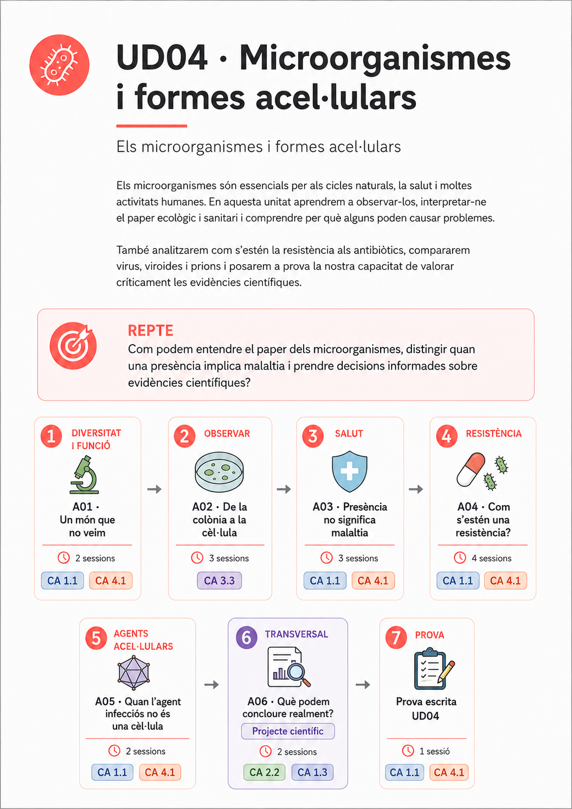
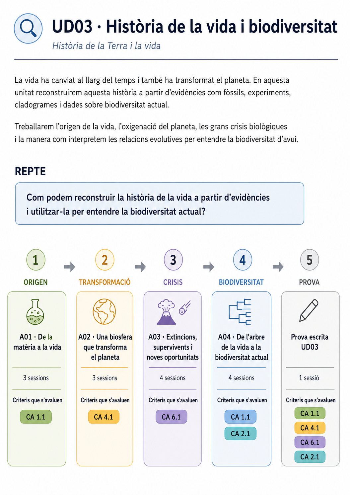
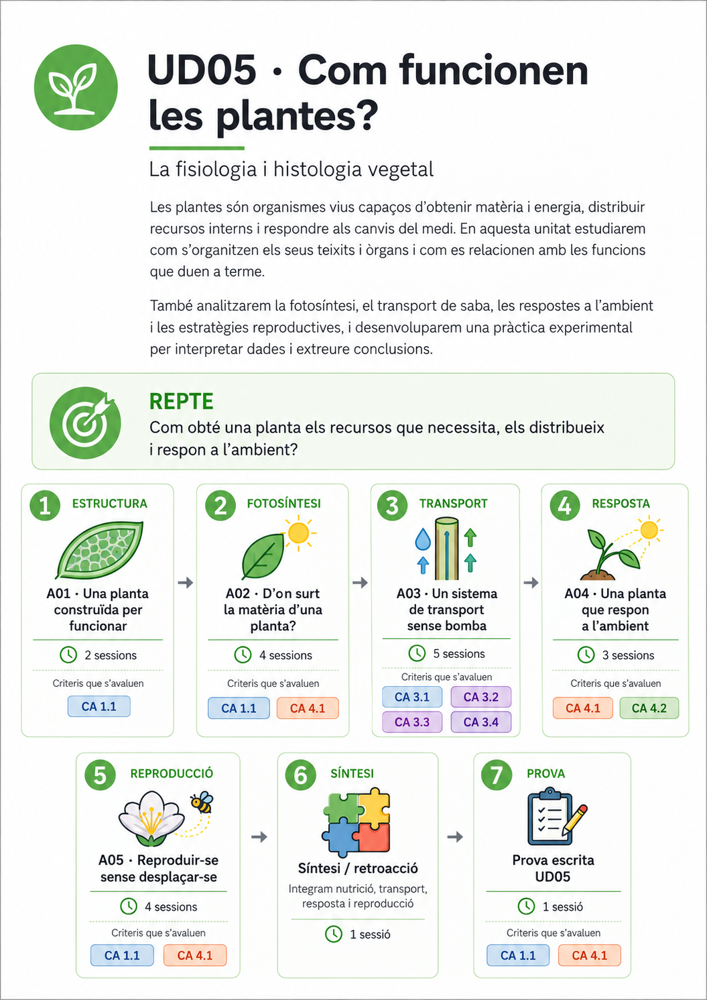
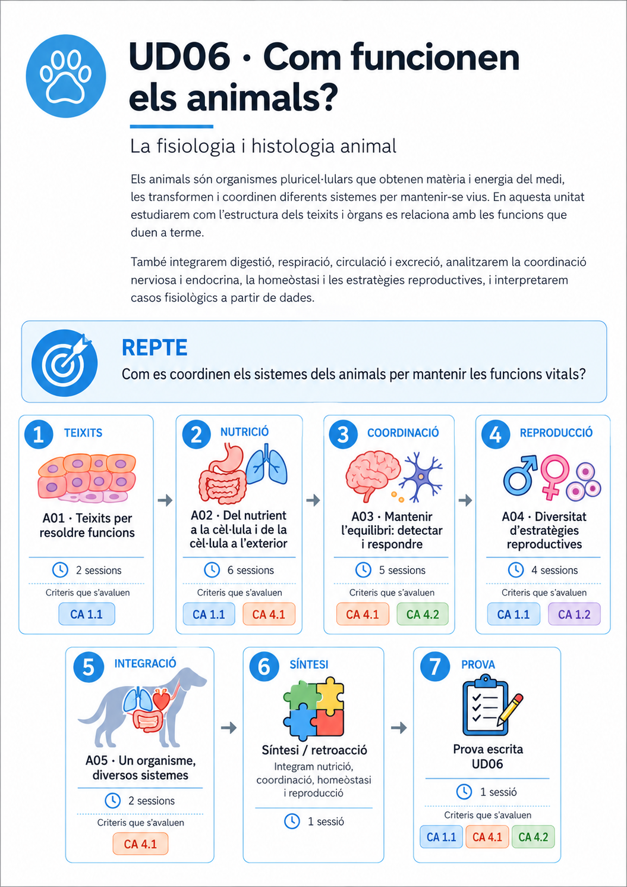
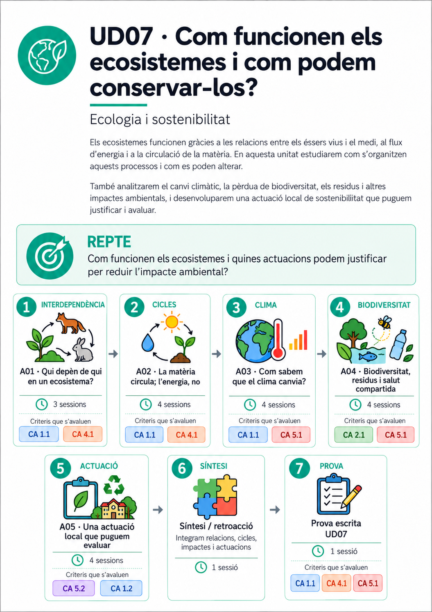

# Calendari del curs

**Biologia, Geologia i Ciències Ambientals · 1r de batxillerat · 2026–2027**

Aquest és el **recorregut visual per les set unitats didàctiques**, distribuïdes en **tres blocs trimestrals**. Cada unitat mostra la **miniatura de la seva infografia resum**. Selecciona-la per obrir la imatge completa en una pestanya nova.

!!! info "Una planificació flexible"
    Els trimestres indiquen una **distribució orientativa**, no dates de començament i finalització tancades. La seqüència es pot adaptar a l'evolució del grup i a les activitats del centre. La programació preveu **133 sessions d'unitats** i **10 sessions de reserva** (143 en total).

<section class="cal-trimestre cal-trimestre--1" markdown="1">

## 1r trimestre

Llegim les evidències del passat i entenem una Terra en moviment.

**39 sessions previstes** · 2 unitats

<article class="cal-ud" markdown="1">

<a class="cal-miniatura cal-miniatura--01" href="infografies/ud01.png" target="_blank" rel="noopener noreferrer" title="Obre la infografia completa de la UD01" aria-label="Obre la infografia completa de la unitat 1 en una pestanya nova">
  
  Amplia la infografia ↗
</a>

### UD01 · Com reconstruïm la història de la Terra?

Evidències del passat, datació i reconstrucció de la història terrestre.

16 sessions · [Obre la unitat](../material/ud1/ud1.md)

</article>

<article class="cal-ud" markdown="1">

<a class="cal-miniatura cal-miniatura--02" href="infografies/ud02.png" target="_blank" rel="noopener noreferrer" title="Obre la infografia completa de la UD02" aria-label="Obre la infografia completa de la unitat 2 en una pestanya nova">
  
  Amplia la infografia ↗
</a>

### UD02 · Una Terra dinàmica

Estructura de la Terra, tectònica, materials, paisatges, riscos i recursos.

23 sessions · [Obre la unitat](../material/ud2/ud2.md)

</article>

</section>

<section class="cal-trimestre cal-trimestre--2" markdown="1">

## 2n trimestre

Exploram la història de la vida, el món microscòpic i les plantes.

**52 sessions previstes** · 3 unitats

<article class="cal-ud" markdown="1">

<a class="cal-miniatura cal-miniatura--03" href="infografies/ud03.png" target="_blank" rel="noopener noreferrer" title="Obre la infografia completa de la UD03" aria-label="Obre la infografia completa de la unitat 3 en una pestanya nova">
  
  Amplia la infografia ↗
</a>

### UD03 · Història de la vida i biodiversitat

Origen i evolució de la vida, grans canvis i diversificació dels organismes.

15 sessions · [Obre la unitat](../material/ud3/ud3.md)

</article>

<article class="cal-ud" markdown="1">

<a class="cal-miniatura cal-miniatura--04" href="infografies/ud04.png" target="_blank" rel="noopener noreferrer" title="Obre la infografia completa de la UD04" aria-label="Obre la infografia completa de la unitat 4 en una pestanya nova">
  
  Amplia la infografia ↗
</a>

### UD04 · Microorganismes i formes acel·lulars

Diversitat microbiana, virus, salut, investigació i resistències.

17 sessions · [Obre la unitat](../material/ud4/ud4.md)

</article>

<article class="cal-ud" markdown="1">

<a class="cal-miniatura cal-miniatura--05" href="infografies/ud05.png" target="_blank" rel="noopener noreferrer" title="Obre la infografia completa de la UD05" aria-label="Obre la infografia completa de la unitat 5 en una pestanya nova">
  
  Amplia la infografia ↗
</a>

### UD05 · Com funcionen les plantes?

Teixits, fotosíntesi, transport, coordinació i reproducció.

20 sessions · [Consulta la programació](programacio_didactica_BGCA_1r_batx_2026-2027_v10.md)

</article>

</section>

<section class="cal-trimestre cal-trimestre--3" markdown="1">

## 3r trimestre

Integram el funcionament dels organismes i dels ecosistemes.

**42 sessions previstes** · 2 unitats

<article class="cal-ud" markdown="1">

<a class="cal-miniatura cal-miniatura--06" href="infografies/ud06.png" target="_blank" rel="noopener noreferrer" title="Obre la infografia completa de la UD06" aria-label="Obre la infografia completa de la unitat 6 en una pestanya nova">
  
  Amplia la infografia ↗
</a>

### UD06 · Com funcionen els animals?

Teixits, nutrició, coordinació, homeòstasi i reproducció.

21 sessions · [Consulta la programació](programacio_didactica_BGCA_1r_batx_2026-2027_v10.md)

</article>

<article class="cal-ud" markdown="1">

<a class="cal-miniatura cal-miniatura--07" href="infografies/ud07.png" target="_blank" rel="noopener noreferrer" title="Obre la infografia completa de la UD07" aria-label="Obre la infografia completa de la unitat 7 en una pestanya nova">
  
  Amplia la infografia ↗
</a>

### UD07 · Com funcionen els ecosistemes i com podem conservar-los?

Xarxes tròfiques, cicles, canvi climàtic, biodiversitat i actuacions locals.

21 sessions · [Consulta la programació](programacio_didactica_BGCA_1r_batx_2026-2027_v10.md)

</article>

</section>

---

### Com llegir aquesta línia de temps?

Les unitats segueixen l'ordre **UD01 → UD07**. Les durades indicades corresponen a la [programació didàctica](programacio_didactica_BGCA_1r_batx_2026-2027_v10.md); no són terminis fixos. Els enllaços de les quatre primeres unitats duen als materials publicats; els de les unitats restants duen, de moment, a la programació.

Les **set infografies resum** estan disponibles com a imatges completes. Les miniatures es mostren sense retallar-ne el contingut; pots seleccionar-ne qualsevol per ampliar-la.
